# Buku Panduan Penggunaan Aplikasi Cek PBB Cianjur

**Aplikasi Utilitas Pelayanan Pajak Daerah & Pencatatan DHKP Desa Mandiri**  
Kabupaten Cianjur · Provinsi Jawa Barat  
*Dokumentasi Resmi & Panduan Pengguna Lengkap*

---

## Daftar Isi

1. [Pendahuluan & Ikhtisar Aplikasi](#1-pendahuluan--ikhtisar-aplikasi)
   - [1.1 Tujuan Aplikasi](#11-tujuan-aplikasi)
   - [1.2 Karakteristik Offline-First & Keamanan](#12-karakteristik-offline-first--keamanan)
2. [Modul Pelayanan Wajib Pajak (Publik)](#2-modul-pelayanan-wajib-pajak-publik)
   - [2.1 Halaman Cek Tagihan PBB](#21-halaman-cek-tagihan-pbb)
   - [2.2 Halaman Cek Status Bayar PBB](#22-halaman-cek-status-bayar-pbb)
   - [2.3 Pemeriksaan Banyak NOP Sekaligus (Massal)](#23-pemeriksaan-banyak-nop-sekaligus-massal)
   - [2.4 Cek Info Pajak Kendaraan Bermotor (Jabar)](#24-cek-info-pajak-kendaraan-bermotor-jabar)
   - [2.5 Cek Desil Kesejahteraan & Bansos (DTKS Kemensos)](#25-cek-desil-kesejahteraan--bansos-dtks-kemensos)
3. [Modul Buku Catatan DHKP Digital](#3-modul-buku-catatan-dhkp-digital)
4. [Modul Khusus Petugas & Kolektor Desa (Portal Staf)](#4-modul-khusus-petugas--kolektor-desa-portal-staf)
   - [4.1 Login Petugas Bapenda](#41-login-petugas-bapenda)
   - [4.2 Verifikasi Keamanan Dua Langkah (MFA)](#42-verifikasi-keamanan-dua-langkah-mfa)
   - [4.3 Menu Utama Petugas Desa (Hub Monitoring)](#43-menu-utama-petugas-desa-hub-monitoring)
   - [4.4 Pantauan Wilayah Desa (7 Laporan Bapenda)](#44-pantauan-wilayah-desa-7-laporan-bapenda)
   - [4.5 Rangking Realisasi Capaian Desa](#45-rangking-realisasi-capaian-desa)
   - [4.6 Modul Pembayaran Kolektif (Rombongan Warga)](#46-modul-pembayaran-kolektif-rombongan-warga)
   - [4.7 Menu Aksi Rombongan & Surat Pengantar](#47-menu-aksi-rombongan--surat-pengantar)
   - [4.8 Formulir Tambah Group Rombongan Baru](#48-formulir-tambah-group-rombongan-baru)
5. [Pengaturan & Personalisasi](#5-pengaturan--personalisasi)
   - [5.1 Tema & Tampilan](#51-tema--tampilan)
   - [5.2 Kunci Keamanan Biometrik / PIN](#52-kunci-keamanan-biometrik--pin)
   - [5.3 Pencadangan & Pemulihan Cadangan Data](#53-pencadangan--pemulihan-cadangan-data)
   - [5.4 Mengaktifkan Ulang Panduan Interaktif](#54-mengaktifkan-ulang-panduan-interaktif)
   - [5.5 Tentang & Bagikan Aplikasi (Profil Pengembang, GitHub, Saweria & Pembaruan)](#55-tentang--bagikan-aplikasi-profil-pengembang-github-saweria--pembaruan)
6. [Informasi Hukum & Privasi](#6-informasi-hukum--privasi)
   - [6.1 Kebijakan Privasi (Privacy Policy)](#61-kebijakan-privasi-privacy-policy)
   - [6.2 Syarat & Ketentuan Layanan (Terms of Service)](#62-syarat--ketentuan-layanan-terms-of-service)
7. [Tanya Jawab & Penyelesaian Masalah (FAQ)](#7-tanya-jawab--penyelesaian-masalah-faq)

---

## 1. Pendahuluan & Ikhtisar Aplikasi

### 1.1 Tujuan Aplikasi
Aplikasi **Cek PBB Cianjur** dirancang khusus untuk mempermudah Wajib Pajak, Kolektor Pajak Dusun/RT/RW, dan Perangkat Desa/Kelurahan di wilayah Kabupaten Cianjur dalam mengecek ketetapan PBB-P2, mengontrol bukti lunas pembayaran, merekap pembagian blok penagihan, serta memantau realisasi penerimaan pajak desa secara *real-time* langsung ke basis data Bapenda.

### 1.2 Karakteristik Offline-First & Keamanan
Aplikasi ini dibangun dengan arsitektur **Offline-First**:
- **Penyimpanan Lokal Mandiri**: Seluruh catatan setoran warga dan berkas DHKP tersimpan di penyimpanan internal perangkat Anda tanpa melewati server komersial pihak ketiga.
- **Koneksi Resmi Langsung**: Saat mengecek tagihan atau mengakses Portal Staf, aplikasi berkomunikasi langsung secara aman (*end-to-end encrypted*) dengan peladen resmi Badan Pendapatan Daerah (Bapenda) Kabupaten Cianjur.
- **Dukungan Cadangan Terenkripsi**: Cadangan data dapat disinkronkan ke akun Google Drive pribadi pengguna untuk pencegahan kehilangan data saat berganti perangkat.

---

## 2. Modul Pelayanan Wajib Pajak (Publik)

### 2.1 Halaman Cek Tagihan PBB

Halaman utama yang digunakan warga atau kolektor untuk memeriksa jumlah tunggakan PBB-P2, denda berjalan, dan melakukan pelunasan instan secara mandiri.

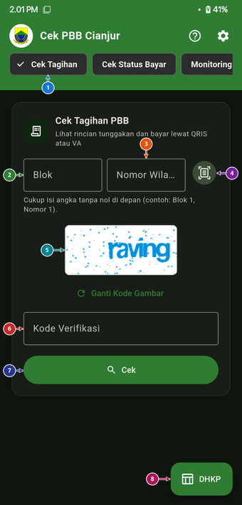

#### Panduan Elemen & Tombol (Sesuai Nomor Titik):
- **① Baris Menu Fitur (`Cek Tagihan`)**: Geser baris tombol di bagian atas ke kiri atau kanan untuk berpindah antarfitur (*Cek Tagihan*, *Cek Status Bayar*, *Monitoring*, *Cek Kendaraan*, dan *Cek Desil*).
- **② Kolom Blok**: Ketik nomor blok tempat objek pajak berada tanpa angka nol di depan (contoh: bila blok Anda `001`, cukup ketik `1`).
- **③ Kolom Nomor Wilayah**: Ketik nomor urut SPPT Anda tanpa angka nol di depan (contoh: bila nomor Anda `0142`, cukup ketik `142`).
- **④ Tombol Pindai Kamera (`Scan SPPT`)**: Menyalakan kamera ponsel untuk memindai kertas SPPT fisik secara otomatis tanpa perlu mengetik nomor manual.
- **⑤ Gambar Kode Keamanan (`Captcha`) & `Ganti Kode Gambar`**: Gambar teks pelindung resmi dari server Bapenda. Ketuk *Ganti Kode Gambar* bila huruf kurang jelas.
- **⑥ Kolom `Kode Verifikasi`**: Ketik huruf/angka captcha yang terlihat pada kotak gambar di atasnya.
- **⑦ Tombol `Cek`**: Menjalankan pencarian tagihan ke server Bapenda dan menampilkan nama wajib pajak, alamat objek, rincian pokok, denda, serta opsi pembayaran QRIS / Virtual Account.
- **⑧ Tombol Mengambang `DHKP`**: Tombol pintas di pojok kanan bawah untuk langsung membuka **Buku Catatan DHKP Digital**.

---

### 2.2 Halaman Cek Status Bayar PBB

Digunakan untuk memastikan apakah suatu objek pajak pada tahun pajak tertentu sudah tercatat lunas di kas daerah atau masih berstatus terutang.

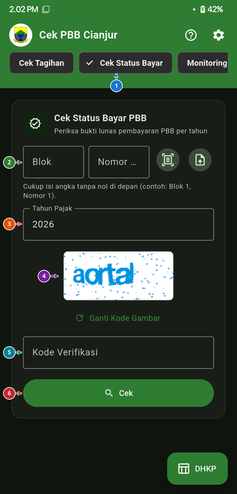

#### Panduan Elemen & Tombol (Sesuai Nomor Titik):
- **① Tab `Cek Status Bayar`**: Menandakan Anda sedang berada di halaman pemeriksaan bukti pelunasan PBB per tahun.
- **② Kolom `Blok`, `Nomor`, Tombol `Scan SPPT` & `Cek Banyak Data`**: Masukkan nomor blok dan nomor urut objek pajak, pindai lembar SPPT lewat kamera, atau ketuk ikon dokumen panah atas di sebelah kanan untuk memeriksa ratusan NOP sekaligus.
- **③ Kolom `Tahun Pajak`**: Menentukan tahun pajak yang ingin diperiksa status pelunasannya (misalnya `2026`).
- **④ Gambar Kode Keamanan (`Captcha`)**: Kode gambar verifikasi resmi dari server Bapenda.
- **⑤ Kolom `Kode Verifikasi`**: Masukkan kode captcha sesuai gambar yang tampil di atasnya.
- **⑥ Tombol `Cek`**: Menampilkan status lunas/belum bayar beserta rincian tanggal pembayaran.

---

### 2.3 Pemeriksaan Banyak NOP Sekaligus (Massal)

Fitur unggulan bagi ketua RT, RW, atau kolektor desa yang harus memeriksa puluhan hingga ratusan data SPPT warga dalam satu waktu tanpa mengecek satu per satu.

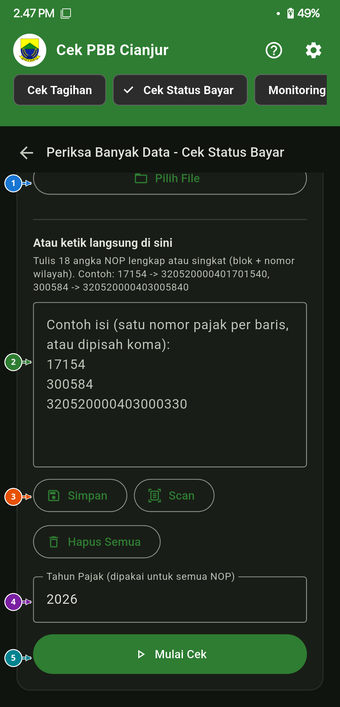

#### Panduan Elemen & Tombol (Sesuai Nomor Titik):
- **① Tombol `Pilih File`**: Membuka pengelola berkas di ponsel untuk memuat file Excel (`.xlsx`), CSV, atau TXT berisi daftar NOP warga.
- **② Kotak Input Daftar NOP**: Tempat mengetik atau menempel (*paste*) banyak NOP sekaligus (satu nomor per baris atau dipisahkan koma). Mendukung NOP lengkap 18 digit maupun format singkat (`blok` + `nomor`, misalnya `17154`).
- **③ Tombol `Simpan`, `Scan`, & `Hapus Semua`**: Menyimpan daftar NOP agar bisa digunakan kembali nanti, menambah NOP dengan memindai SPPT satu per satu, atau mengosongkan kotak input.
- **④ Kolom `Tahun Pajak`**: Menentukan tahun pajak yang dipakai serentak untuk seluruh NOP di dalam daftar.
- **⑤ Tombol `Mulai Cek`**: Memulai proses pengecekan berurutan secara otomatis dan menyajikan rekap hasilnya.

---

### 2.4 Cek Info Pajak Kendaraan Bermotor (Jabar)

Layanan utilitas tambahan bagi warga Cianjur untuk mengecek Pajak Kendaraan Bermotor (PKB) dan SWDKLLJ wilayah Jawa Barat.

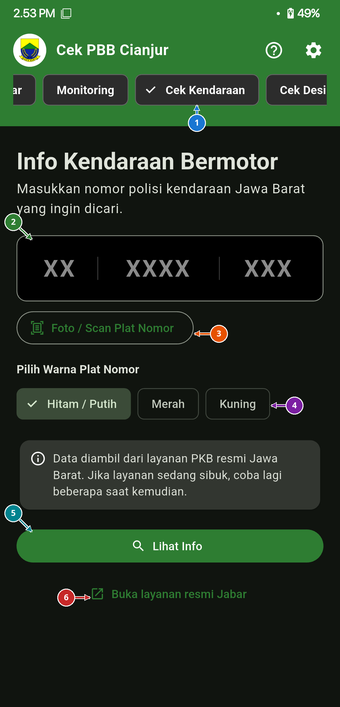

#### Panduan Elemen & Tombol (Sesuai Nomor Titik):
- **① Tab `Cek Kendaraan`**: Membuka layanan pengecekan informasi pajak kendaraan bermotor Jawa Barat.
- **② Kolom Nomor Polisi (`XX | XXXX | XXX`)**: Terbagi menjadi 3 bagian: kode wilayah depan (`F`), nomor urut polisi (`1234`), dan seri huruf belakang (`WA`).
- **③ Tombol `Foto / Scan Plat Nomor`**: Memindai plat nomor kendaraan secara langsung menggunakan kamera ponsel.
- **④ Pilihan `Warna Plat Nomor`**: Pilih warna dasar plat kendaraan (**Hitam / Putih** untuk pribadi, **Merah** untuk kendaraan dinas pemerintah, atau **Kuning** untuk angkutan umum).
- **⑤ Tombol `Lihat Info`**: Mengambil rincian merek, tipe kendaraan, masa berlaku STNK/PKB, serta nominal pajak dari layanan PKB resmi Jawa Barat.
- **⑥ Tautan `Buka layanan resmi Jabar`**: Membuka situs web resmi Bapenda Jawa Barat (Sambara/Samsat) di peramban jika diperlukan.

---

### 2.5 Cek Desil Kesejahteraan & Bansos (DTKS Kemensos)

Layanan terintegrasi untuk memeriksa status kepesertaan bantuan sosial dan tingkat kesejahteraan (Desil) warga dari layanan resmi Kemensos.

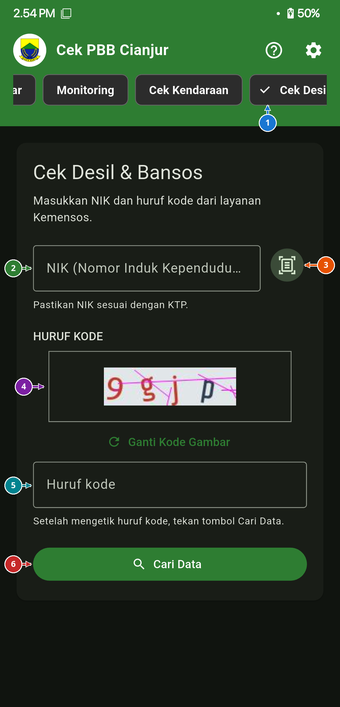

#### Panduan Elemen & Tombol (Sesuai Nomor Titik):
- **① Tab `Cek Desil`**: Membuka halaman pemeriksaan data Desil & Bantuan Sosial.
- **② Kolom `NIK (Nomor Induk Kependudukan)`**: Masukkan 16 digit NIK sesuai KTP atau Kartu Keluarga warga.
- **③ Tombol Pindai KTP/KK**: Memindai angka NIK secara otomatis dari foto KTP/KK menggunakan kamera.
- **④ Gambar `Huruf Kode` & `Ganti Kode Gambar`**: Menampilkan kode keamanan dari layanan Kemensos.
- **⑤ Kolom `Huruf kode`**: Ketik huruf kode sesuai gambar captcha di atasnya.
- **⑥ Tombol `Cari Data`**: Menampilkan informasi desil kesejahteraan dan status penerima bantuan sosial warga.

---

## 3. Modul Buku Catatan DHKP Digital

Buku catatan digital bagi perangkat desa dan kolektor untuk mengelola Daftar Himpunan Ketetapan Pajak & Pembayaran (DHKP) secara *offline-first* di ponsel.

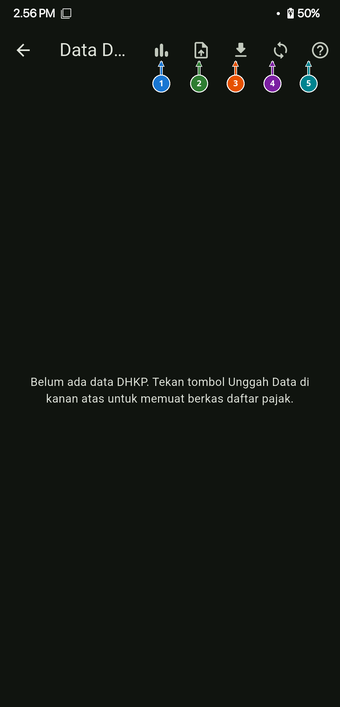

#### Panduan Ikon Bilah Atas (Sesuai Nomor Titik):
- **① Ikon Grafik Ringkasan**: Beralih antara tampilan tabel daftar wajib pajak dan grafik statistik capaian per blok.
- **② Ikon Unggah Berkas DHKP**: Memuat berkas Excel DHKP desa (`.xlsx`/`.xls`) dari penyimpanan perangkat ke dalam aplikasi.
- **③ Ikon Unduh / Ekspor Laporan**: Mengekspor hasil pencatatan lapangan kembali menjadi berkas laporan Excel siap cetak.
- **④ Ikon Sinkronisasi**: Menyinkronkan perubahan catatan DHKP dengan cadangan penyimpanan atau Google Drive.
- **⑤ Ikon Panduan (`?`)**: Menampilkan kembali panduan tur interaktif penggunaan halaman DHKP.

---

## 4. Modul Khusus Petugas & Kolektor Desa (Portal Staf)

Modul ini dikhususkan bagi petugas desa/kelurahan dan kolektor resmi yang memiliki akun Portal Staf Bapenda Kabupaten Cianjur.

### 4.1 Login Petugas Bapenda

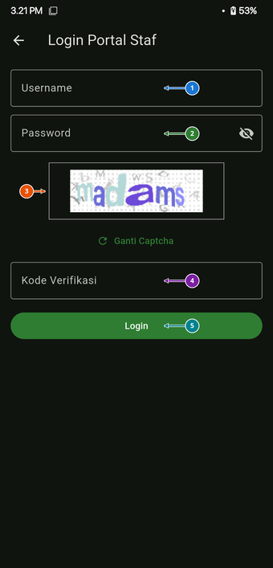

#### Panduan Elemen & Tombol (Sesuai Nomor Titik):
- **① Kolom `Username`**: Masukkan nama pengguna (*username*) akun staf desa/kelurahan Anda.
- **② Kolom `Password`**: Masukkan kata sandi akun staf (ketuk ikon mata di kanan untuk melihat/menyembunyikan ketikan).
- **③ Gambar `Captcha` & `Ganti Captcha`**: Kode keamanan verifikasi server portal staf.
- **④ Kolom `Kode Verifikasi`**: Ketik kode yang tertera pada gambar captcha di atasnya.
- **⑤ Tombol `Login`**: Masuk ke sistem Portal Staf dan melanjutkan ke tahap verifikasi dua langkah (MFA).

---

### 4.2 Verifikasi Keamanan Dua Langkah (MFA)

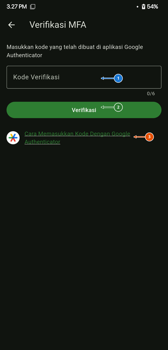

#### Panduan Elemen & Tombol (Sesuai Nomor Titik):
- **① Kolom `Kode Verifikasi` (6 Digit OTP)**: Masukkan 6 digit angka kode sementara yang tampil pada aplikasi **Google Authenticator** di ponsel Anda.
- **② Tombol `Verifikasi`**: Mengonfirmasi kode OTP untuk membuka **Menu Petugas Desa**.
- **③ Tautan `Cara Memasukkan Kode Dengan Google Authenticator`**: Membuka panduan langkah demi langkah cara menghubungkan dan melihat kode 6 digit di aplikasi Google Authenticator.

---

### 4.3 Menu Utama Petugas Desa (Hub Monitoring)

Setelah berhasil login dan verifikasi MFA, petugas akan masuk ke halaman **Menu Petugas Desa**:

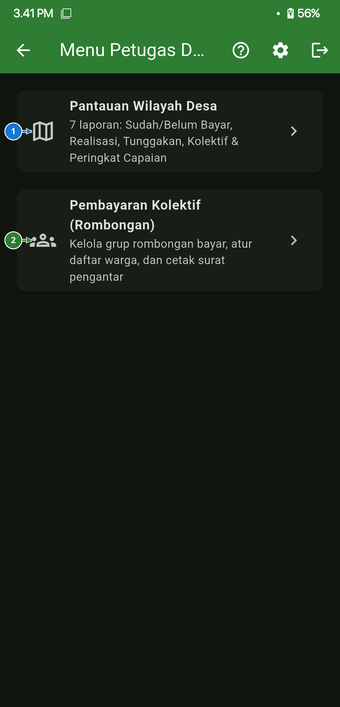

#### Panduan Menu (Sesuai Nomor Titik):
- **① Kartu `Pantauan Wilayah Desa`**: Membuka 7 jenis laporan penerimaan PBB wilayah desa/kelurahan (*Sudah Bayar*, *Belum Bayar*, *Realisasi*, *Piutang*, *Sudah Bayar Kolektif*, *Belum Bayar Kolektif*, dan *Rangking Realisasi*).
- **② Kartu `Pembayaran Kolektif (Rombongan)`**: Membuka halaman pengelolaan grup pembayaran kolektif warga, anggota rombongan, dan pencetakan surat pengantar bayar.

---

### 4.4 Pantauan Wilayah Desa (7 Laporan Bapenda)

Menampilkan data penerimaan pajak secara transparan dan terperinci untuk wilayah desa/kelurahan yang mengikuti akun staf yang sedang login.

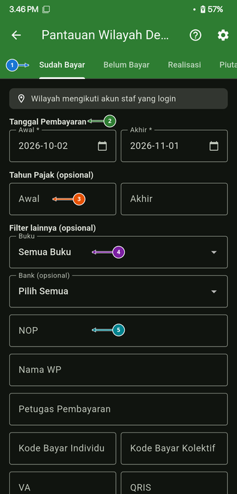

#### Panduan Elemen & Tombol (Sesuai Nomor Titik):
- **① Baris 7 Tab Laporan**: Geser tab bagian atas ke kiri/kanan untuk memilih jenis laporan (*Sudah Bayar*, *Belum Bayar*, *Realisasi*, *Piutang*, *Sudah Bayar Kolektif*, *Belum Bayar Kolektif*, atau *Rangking Realisasi*).
- **② Filter `Tanggal Pembayaran` (`Awal` & `Akhir`)**: Tentukan rentang tanggal transaksi pembayaran yang ingin ditampilkan.
- **③ Filter `Tahun Pajak (opsional)`**: Saring data berdasarkan rentang tahun ketetapan pajak tertentu.
- **④ Filter `Buku` & `Bank (opsional)`**: Saring laporan berdasarkan kategori Buku ketetapan (Buku 1–5) atau kanal bank tempat pembayaran.
- **⑤ Kolom Pencarian Spesifik (`NOP`, `Nama WP`, `Petugas Pembayaran`, `Kode Bayar`)**: Cari transaksi tertentu berdasarkan NOP, nama wajib pajak, petugas pemungut, kode bayar individu/kolektif, VA, atau QRIS.

---

### 4.5 Rangking Realisasi Capaian Desa

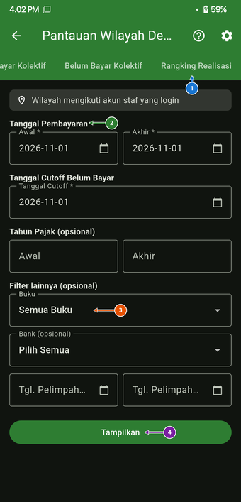

#### Panduan Elemen & Tombol (Sesuai Nomor Titik):
- **① Tab `Rangking Realisasi`**: Menampilkan laporan peringkat capaian realisasi PBB antarwilayah.
- **② Filter `Tanggal Pembayaran` & `Tanggal Cutoff Belum Bayar`**: Mengatur periode tanggal realisasi dan batas tanggal perhitungan tunggakan (*cutoff*).
- **③ Filter `Buku` & `Bank`**: Menyaring perhitungan peringkat berdasarkan kategori buku pajak dan kanal pembayaran.
- **④ Tombol `Tampilkan`**: Memuat tabel peringkat realisasi lengkap beserta persentase capaian.

---

### 4.6 Modul Pembayaran Kolektif (Rombongan Warga)

Memungkinkan petugas desa/kolektor menggabungkan banyak NOP warga ke dalam satu grup rombongan bayar resmi.

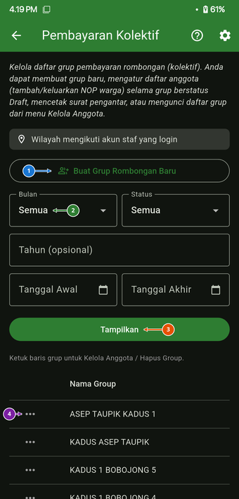

#### Panduan Elemen & Tombol (Sesuai Nomor Titik):
- **① Tombol `Buat Grup Rombongan Baru`**: Membuka formulir pembuatan grup pembayaran kolektif baru untuk wilayah desa Anda.
- **② Filter `Bulan` & `Status`**: Menyaring daftar grup berdasarkan bulan pembuatan dan status grup (*Semua*, *Draft*, *Sudah Di Bayar*, dll.).
- **③ Tombol `Tampilkan`**: Memperbarui daftar grup rombongan sesuai filter yang dipilih.
- **④ Daftar Baris Grup Rombongan (`Nama Group`)**: Menampilkan daftar grup kolektif yang telah dibuat. Ketuk salah satu baris grup (atau ikon `...`) untuk membuka menu aksi grup.

---

### 4.7 Menu Aksi Rombongan & Surat Pengantar

Saat salah satu baris grup pada daftar **Pembayaran Kolektif** diketuk, akan muncul panel menu aksi di bagian bawah layar:

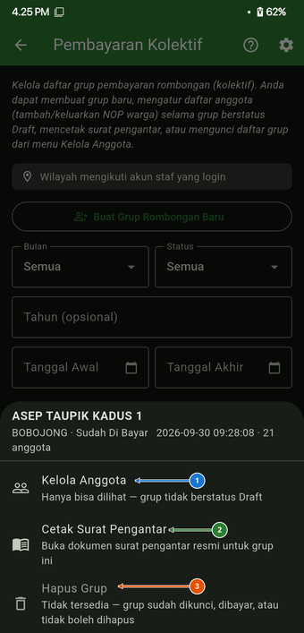

#### Panduan Menu Aksi (Sesuai Nomor Titik):
- **① `Kelola Anggota`**: Membuka daftar anggota NOP warga di dalam grup tersebut. Selama grup masih berstatus *Draft*, petugas dapat menambah atau mengeluarkan NOP warga serta mengunci daftar grup. Jika grup sudah dibayar/dikunci, daftar anggota tetap dapat dilihat.
- **② `Cetak Surat Pengantar`**: Membuka dan mengunduh dokumen surat pengantar resmi pembayaran kolektif untuk grup tersebut.
- **③ `Hapus Grup`**: Menghapus grup rombongan (hanya tersedia apabila grup masih berstatus *Draft* dan belum dikunci atau dibayar).

---

### 4.8 Formulir Tambah Group Rombongan Baru

Ketika petugas mengetuk tombol **`Buat Grup Rombongan Baru`**, akan tampil jendela dialog **Tambah Group** berikut:

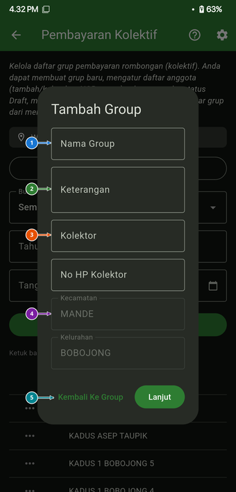

> **Catatan Penting**: Pembuatan grup rombongan tercatat secara **permanen** di server. Pastikan seluruh data nama grup dan kolektor sudah benar sebelum menekan tombol **Lanjut**, atau ketuk **Kembali Ke Group** jika ingin membatalkan.

#### Panduan Elemen Formulir (Sesuai Nomor Titik):
- **① Kolom `Nama Group`**: Masukkan nama identifikasi grup rombongan (misalnya nama kadus/kolektor dan nomor rombongan).
- **② Kolom `Keterangan`**: Tambahkan catatan atau keterangan pendukung mengenai grup setoran tersebut.
- **③ Kolom `Kolektor` & `No HP Kolektor`**: Masukkan nama petugas pemungut/kolektor penanggung jawab beserta nomor telepon aktifnya.
- **④ Informasi `Kecamatan` & `Kelurahan`**: Terisi secara otomatis menyesuaikan wilayah akun staf desa/kelurahan yang sedang login (misalnya Kecamatan `MANDE`, Kelurahan `BOBOJONG`).
- **⑤ Tombol `Kembali Ke Group` & `Lanjut`**: Ketuk **Kembali Ke Group** untuk menutup formulir tanpa menyimpan, atau ketuk **Lanjut** untuk membuat grup secara permanen dan masuk ke pengelolaan anggota.

---

## 5. Pengaturan & Personalisasi

Halaman **Pengaturan** dapat diakses melalui ikon roda gigi (`⚙`) di pojok kanan atas aplikasi untuk menyesuaikan tampilan, keamanan, pencadangan data, serta melihat informasi aplikasi dan pengembang.

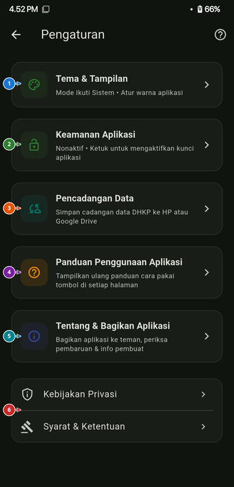

#### Panduan Menu Pengaturan (Sesuai Nomor Titik):
- **① `Tema & Tampilan`**: Mengatur mode layar (Terang/Gelap/Ikuti Sistem) dan warna tema aplikasi.
- **② `Keamanan Aplikasi`**: Mengaktifkan penguncian aplikasi menggunakan sidik jari (*biometrik*) atau PIN perangkat.
- **③ `Pencadangan Data`**: Mengelola pencadangan dan pemulihan data DHKP ke penyimpanan ponsel maupun Google Drive.
- **④ `Panduan Penggunaan Aplikasi`**: Menampilkan ulang tur panduan interaktif pada setiap halaman aplikasi.
- **⑤ `Tentang & Bagikan Aplikasi`**: Membagikan file APK, melihat profil pengembang (**Ikbal `@IkbalGumilar`**), membuka tautan **GitHub** & **Saweria**, serta memeriksa pembaruan versi aplikasi.
- **⑥ `Kebijakan Privasi` & `Syarat & Ketentuan`**: Membaca dokumen resmi perlindungan privasi dan ketentuan penggunaan aplikasi.

---

### 5.1 Tema & Tampilan

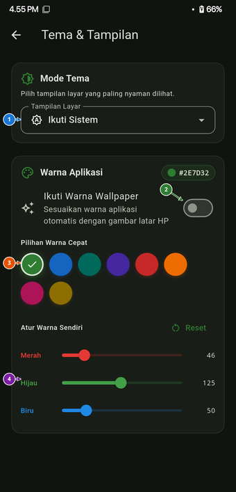

#### Panduan Elemen (Sesuai Nomor Titik):
- **① Pilihan `Tampilan Layar` (`Mode Tema`)**: Pilih antara **Ikuti Sistem**, **Mode Terang**, atau **Mode Gelap**.
- **② Sakelar `Ikuti Warna Wallpaper`**: Menyesuaikan skema warna aplikasi secara otomatis mengikuti warna gambar latar (*wallpaper*) ponsel Anda.
- **③ Palet `Pilihan Warna Cepat`**: Memilih warna aksen aplikasi secara instan dari 8 pilihan warna yang tersedia.
- **④ Slider `Atur Warna Sendiri` (`Merah`, `Hijau`, `Biru`)**: Mengatur kombinasi warna RGB secara bebas sesuai selera Anda (dilengkapi tombol `Reset` untuk kembali ke warna bawaan).

---

### 5.2 Kunci Keamanan Biometrik / PIN

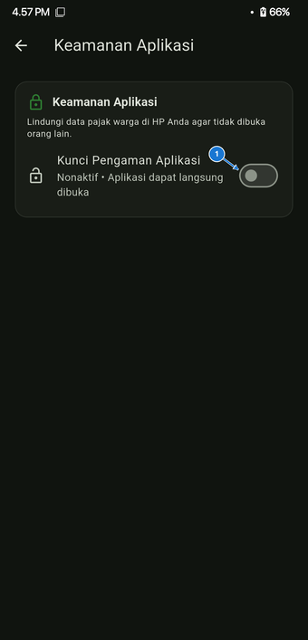

#### Panduan Elemen (Sesuai Nomor Titik):
- **① Sakelar `Kunci Pengaman Aplikasi`**: Saat diaktifkan, aplikasi akan meminta autentikasi keamanan perangkat (Sidik Jari, Wajah, atau PIN/Pola layar kunci) setiap kali dibuka agar data pajak warga tetap terlindungi.

---

### 5.3 Pencadangan & Pemulihan Cadangan Data

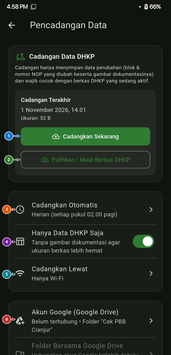

#### Panduan Elemen (Sesuai Nomor Titik):
- **① Tombol `Cadangkan Sekarang`**: Menyimpan salinan cadangan perubahan data DHKP beserta dokumentasinya secara langsung.
- **② Tombol `Pulihkan / Muat Berkas DHKP`**: Memulihkan data cadangan yang pernah disimpan sebelumnya ke dalam aplikasi.
- **③ Menu `Cadangkan Otomatis`**: Mengatur jadwal pencadangan otomatis (misalnya *Harian setiap pukul 02.00 pagi*).
- **④ Sakelar `Hanya Data DHKP Saja`**: Menghemat ukuran berkas cadangan dengan hanya menyimpan data tabel DHKP tanpa menyertakan lampiran gambar dokumentasi.
- **⑤ Menu `Cadangkan Lewat`**: Memilih jaringan untuk pencadangan otomatis (*Hanya Wi-Fi* atau termasuk data seluler).
- **⑥ Menu `Akun Google (Google Drive)`**: Menghubungkan akun Google Anda agar berkas cadangan tersimpan aman di dalam folder `"Cek PBB Cianjur"` pada Google Drive.

---

### 5.4 Mengaktifkan Ulang Panduan Interaktif

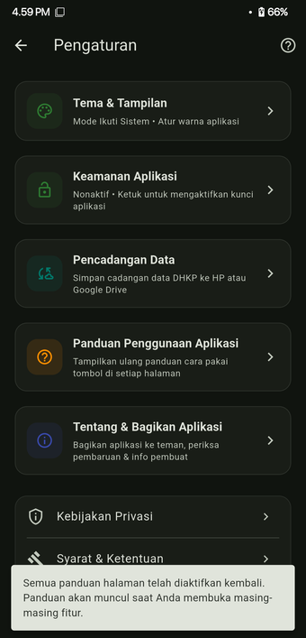

Mengetuk menu **`Panduan Penggunaan Aplikasi`** akan mengaktifkan kembali seluruh petunjuk tur interaktif di setiap halaman, lalu membawa Anda kembali ke layar utama dengan panduan langkah demi langkah yang siap digunakan.

---

### 5.5 Tentang & Bagikan Aplikasi (Profil Pengembang, GitHub, Saweria & Pembaruan)

Halaman **`Tentang & Bagikan Aplikasi`** memuat informasi versi rilis aplikasi, fitur berbagi instalasi APK, profil pengembang, tautan komunitas/dukungan, serta pemeriksa pembaruan.

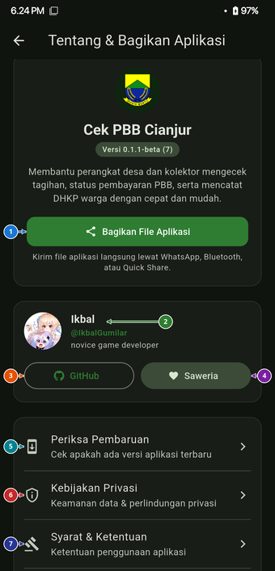

#### Panduan Elemen & Tombol (Sesuai Nomor Titik):
- **① Tombol `Bagikan File Aplikasi`**: Mengirimkan berkas instalasi aplikasi (`.apk`) **Cek PBB Cianjur** secara langsung kepada rekan perangkat desa, kolektor, atau warga melalui **WhatsApp**, **Bluetooth**, atau **Quick Share** tanpa perlu mengunduh ulang dari internet.
- **② Kartu Profil Pengembang (`Ikbal` · `@IkbalGumilar`)**: Menampilkan foto profil, nama pengembang (**Ikbal**), nama pengguna (`@IkbalGumilar`), serta deskripsi singkat pengembang (*novice game developer*).
- **③ Tombol Tautan `GitHub`**: Membuka halaman profil dan repositori **GitHub** resmi pengembang (`@IkbalGumilar`) untuk melihat perkembangan proyek, dokumentasi teknis, maupun menyampaikan masukan/laporan kendala (*issue*).
- **④ Tombol Tautan `Saweria`**: Membuka halaman dukungan **Saweria** resmi pengembang bagi pengguna yang ingin memberikan apresiasi atau donasi sukarela guna mendukung pengembangan dan pemeliharaan aplikasi secara berkelanjutan.
- **⑤ Menu `Periksa Pembaruan`**: Memeriksa secara langsung ke server rilis apakah tersedia versi terbaru dari aplikasi **Cek PBB Cianjur** agar Anda selalu mendapatkan fitur dan perbaikan terkini.
- **⑥ Menu `Kebijakan Privasi`**: Membuka halaman dokumen keamanan data dan perlindungan privasi pengguna.
- **⑦ Menu `Syarat & Ketentuan`**: Membuka halaman ketentuan penggunaan aplikasi secara lengkap.

---

## 6. Informasi Hukum & Privasi

### 6.1 Kebijakan Privasi (Privacy Policy)

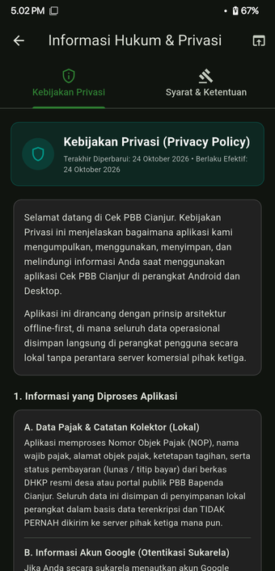

- **100% Penyimpanan Lokal (*Offline-First*)**: Berkas DHKP (Excel/CSV) dan catatan pembayaran disimpan langsung di ruang penyimpanan internal ponsel Anda.
- **Tanpa Pelacakan Komersial**: Aplikasi tidak memanen data pribadi, tidak memasang iklan pihak ketiga, dan hanya menggunakan izin kamera/penyimpanan semata-mata ketika Anda menjalankan fitur pindai SPPT/KTP atau mencadangkan berkas DHKP.

---

### 6.2 Syarat & Ketentuan Layanan (Terms of Service)

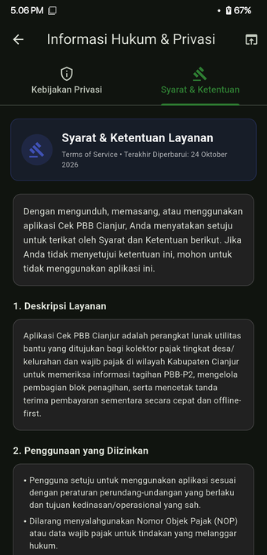

- **Fungsi Sebagai Alat Bantu**: Aplikasi ini merupakan sarana utilitas bantu operasional pencatatan pajak. Bukti pelunasan yang sah secara hukum tetap mengacu pada struk bank, bukti QRIS, atau cetakan resmi dari sistem Bapenda Kabupaten Cianjur.
- **Kewajiban Menjaga Kerahasiaan Data**: Pengguna (khususnya kolektor dan perangkat desa) wajib menjaga kerahasiaan data wajib pajak yang tercantum di dalam berkas DHKP serta akun Portal Staf masing-masing.

---

## 7. Tanya Jawab & Penyelesaian Masalah (FAQ)

#### Q: Mengapa saat mengecek tagihan muncul keterangan "Kode Verifikasi Salah"?
> **Jawab**: Pastikan Anda mengetik huruf atau angka sesuai gambar captcha yang tampil. Jika gambar tampak kurang jelas, ketuk tombol **`Ganti Kode Gambar`** untuk memuat gambar kode baru.

#### Q: Bagaimana jika lembar SPPT fisik warga tidak memiliki barcode untuk dipindai?
> **Jawab**: Anda tetap dapat mengecek tagihan dengan mengetik nomor **Blok** dan **Nomor Wilayah** secara manual tanpa angka nol di depan (misalnya Blok `1`, Nomor `1`).

#### Q: Apakah data catatan DHKP di ponsel saya akan hilang jika berganti ponsel baru?
> **Jawab**: Tidak, selama Anda telah mencadangkan data melalui menu **`Pengaturan > Pencadangan Data`**, baik menggunakan berkas lokal maupun menghubungkan akun **Google Drive**, lalu memilih **`Pulihkan / Muat Berkas DHKP`** di perangkat yang baru.

#### Q: Bagaimana cara membagikan aplikasi ini ke rekan kolektor desa lain?
> **Jawab**: Buka menu **`Pengaturan > Tentang & Bagikan Aplikasi`**, lalu ketuk tombol hijau **`Bagikan File Aplikasi`** (poin **①**). Anda dapat langsung mengirim file aplikasinya lewat WhatsApp, Bluetooth, atau Quick Share.

---

**Cek PBB Cianjur** · Membangun Pelayanan Pajak Daerah yang Cepat, Transparan, dan Akuntabel.  
*Dokumentasi ini diperbarui mengikuti versi rilis aplikasi terbaru.*
