# Cek PBB Cianjur

[](https://github.com/IkbalGumilar/Cek-PBB-Cianjur/releases/latest)
[](https://flutter.dev)
[](https://dart.dev)
[]()
[]()
[](LICENSE)

Aplikasi manajemen, pengecekan, monitoring, dan pelaporan Pajak Bumi dan Bangunan Perdesaan dan Perkotaan (PBB-P2) yang dirancang khusus untuk memfasilitasi kerja kolektor dan staf desa/kelurahan di Kabupaten Cianjur. Aplikasi ini terhubung langsung secara terenkripsi ke portal resmi BAPENDA Kabupaten Cianjur tanpa memerlukan navigasi manual antarmuka peramban web.

> [!NOTE]
> **Distribusi Mandiri (Sideload & Multi-Platform)**  
> Aplikasi ini didistribusikan secara mandiri melalui [GitHub Releases](https://github.com/IkbalGumilar/Cek-PBB-Cianjur/releases/latest) berupa paket **APK teroptimasi per arsitektur (*Split per ABI*)** untuk Android, paket **Installer Mandiri Inno Setup (`.exe`)** & **Portable (`.zip`)** untuk Windows x64, serta paket biner portabel untuk Linux Desktop.

---

## 📱 Galeri Tangkapan Layar Aplikasi

<p align="center">
  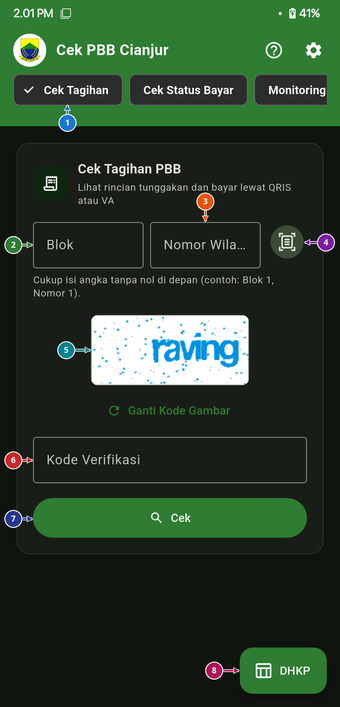
  &nbsp;&nbsp;
  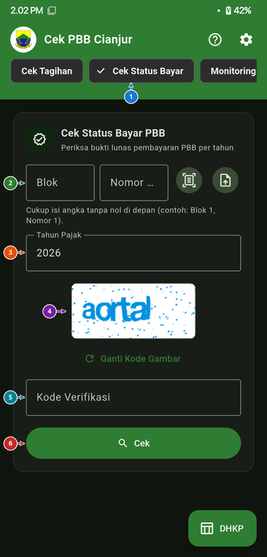
  &nbsp;&nbsp;
  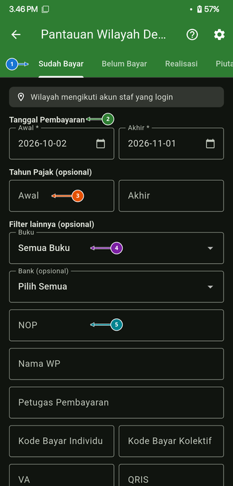
  &nbsp;&nbsp;
  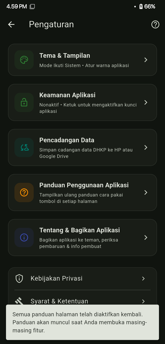
</p>

---

## Daftar Isi
- [Fitur Utama](#-fitur-utama)
- [Arsitektur Keamanan](#-arsitektur-keamanan)
- [Matriks Dukungan Platform](#-matriks-dukungan-platform)
- [Panduan Modul & Tangkapan Layar](#-panduan-modul--tangkapan-layar)
  - [1. Pengecekan PBB-P2 & Pembayaran Multi-Kanal](#1-pengecekan-pbb-p2--pembayaran-multi-kanal)
  - [2. Cek Banyak NOP Sekaligus](#2-cek-banyak-nop-sekaligus)
  - [3. Manajemen Data DHKP & Catatan Blok](#3-manajemen-data-dhkp--catatan-blok)
  - [4. Diagram Batang & Analitik Capaian DHKP Desktop Adaptif](#4-diagram-batang--analitik-capaian-dhkp-desktop-adaptif)
  - [5. Monitoring Wilayah & Portal Staf BAPENDA (MFA)](#5-monitoring-wilayah--portal-staf-bapenda-mfa)
  - [6. Pembayaran Kolektif & Surat Pengantar](#6-pembayaran-kolektif--surat-pengantar)
  - [7. Cek Pajak Kendaraan Bermotor (Jawa Barat)](#7-cek-pajak-kendaraan-bermotor-jawa-barat)
  - [8. Cek Desil & Bantuan Sosial (Kemensos)](#8-cek-desil--bantuan-sosial-kemensos)
  - [9. Buku Panduan Penggunaan & Pusat Bantuan Interaktif](#9-buku-panduan-penggunaan--pusat-bantuan-interaktif)
  - [10. Kustomisasi Tema, Keamanan & Pencadangan Data](#10-kustomisasi-tema-keamanan--pencadangan-data)
- [Alur Pembaruan Otomatis](#-alur-pembaruan-otomatis)
- [Panduan Pengembangan & Kompilasi](#-panduan-pengembangan--kompilasi)
- [Pernyataan Privasi & Penafian](#-pernyataan-privasi--penafian)

---

## 🌟 Fitur Utama

- **Pengecekan NOP Cepat & Akurat**: Cukup ketik format ringkas Blok dan Nomor Wilayah (misal: Blok `1` Nomor `1`), sistem otomatis memformat menjadi NOP 18 digit resmi BAPENDA (`32.03...`).
- **Pembayaran Multi-Kanal**:
  - **QRIS Dinamis**: Kode QR berlaku 1 jam sekali pakai, kompatibel dengan seluruh aplikasi dompet digital & m-banking di Indonesia (semua platform).
  - **Virtual Account Bank BJB**: Pembuatan nomor VA instan dengan integrasi pembuka aplikasi perbankan lokal yang terpasang di perangkat *(khusus Android)*.
- **Manajemen DHKP (Daftar Himpunan Ketetapan Pajak)**:
  - Pelacakan 4 indikator metrik utama: **Sudah Bayar**, **Belum Bayar**, **Target Pemda**, dan **Blacklist (Menunggak ≥ 5 Tahun)**.
  - Pencatatan riwayat penagihan, status objek pajak, foto lokasi/bukti bayar dengan zoom interaktif, dan penambahan catatan khusus kolektor.
  - **Ekspor Kolase Foto**: Penggabungan foto objek pajak/SPPT per blok ke dalam dokumen laporan siap cetak atau dibagikan ke instansi pembina.
- **Diagram Capaian Desktop Adaptif**:
  - Visualisasi grafik capaian persentase, pendapatan masuk, sisa tagihan, dan tren bulanan ala Microsoft Excel / Power BI.
  - **Mode Pas Layar (Fit-to-Screen)**: Menampilkan seluruh 41 blok desa sekaligus dalam satu pandangan monitor tanpa terpotong.
  - **Mode Bisa Digeser (Scrollable)**: Dilengkapi dukungan klik & seret mouse (*mouse drag-to-scroll*), roda scroll mouse (*mouse wheel*), dan scrollbar horizontal interaktif.
- **Buku Panduan & Pusat Bantuan Interaktif (Terbaru di v0.1.2-beta)**:
  - Modul dokumentasi visual 19 bab dengan 84 titik pin koordinat interaktif, pencarian cepat, filter kategori, mode zoom layar penuh, dan FAQ lengkap.
- **Tur Fitur Spotlight Dinamis 60 FPS**:
  - Memandu pengguna baru mengenal letak tombol dan alur kerja aplikasi secara visual dengan sorotan spotlight yang mengikuti posisi layar secara dinamis.
- **Asosiasi Berkas Cerdas (WhatsApp & File Manager)**:
  - Berkas arsip `.dkhp`, `.dhkp`, maupun laporan perubahan `.dat` dapat diketuk langsung dari chat WhatsApp atau pengelola berkas Android untuk membuka aplikasi dan memulihkan data otomatis.
- **Sinkronisasi Multi-Petugas & Cloud Backup**:
  - Terintegrasi langsung dengan Google Drive API untuk mengunduh dan menyinkronkan data antar-kolektor.
  - Protokol delta sync terenkripsi untuk penggabungan perubahan catatan tanpa menimpa data rekan kerja.
  - Penjadwalan cadangan harian otomatis berkala (pukul 02:00) dengan kebijakan rotasi retensi 3 berkas terlama.
- **OCR Offline Lokal (Edge ML)**:
  - Pemindaian berkas NOP dari gambar fisik STTS/SPPT tanpa koneksi internet *(khusus Android)*.
  - Pemindaian KTP/KK untuk input NIK 16 digit pada modul Bansos.
  - Pemindaian Plat Nomor Kendaraan (TNKB) dengan deteksi warna permukaan plat.
- **Portal Monitoring Staf BAPENDA**:
  - Akses aman berbasis kredensial staf + autentikasi dua faktor (Google Authenticator MFA).
  - Monitoring piutang, realisasi per wilayah (Kecamatan/Kelurahan), rangking realisasi, dan pencetakan surat pengantar pembayaran kolektif.
- **Keamanan Sistem Berlapis**:
  - Proteksi kunci biometrik (sidik jari/wajah), PIN 6-digit terenkripsi, atau kata sandi aplikasi dengan auto-lockout cerdas.
  - Enkripsi arsip `.dkhp` standar militer (PBKDF2-HMAC-SHA256 600.000 iterasi + AES-256-GCM).
  - Pengaktifan `FLAG_SECURE` pada Android untuk mencegah perekaman layar dan tangkapan layar tanpa izin.

---

## 🛡️ Arsitektur Keamanan

Aplikasi ini memprioritaskan kerahasiaan dan integritas data wajib pajak melalui implementasi standar kriptografi modern:

```
[Arsip Paket Data (.dkhp)]
         │
         ▼
[PBKDF2-HMAC-SHA256 (600.000 Iterasi + Salt Kriptografis)]
         │
         ▼ (Turunkan Kunci 256-bit)
[Enkripsi Terotentikasi: AES-256-GCM]
         │
         ├── Header AAD (Authenticated Additional Data: Magic Byte, Versi, Metadata)
         ├── Tag Autentikasi 128-bit (Pencegahan Manipulasi / Integritas Data)
         └── Data Terkompresi (CSV DHKP, Catatan Kolektor, Delta Sinkronisasi)
```

1. **Enkripsi Kunci & Arsip (`.dkhp`)**:
   - Seluruh data lokal dan cadangan diekspor menggunakan format kontainer terotentikasi AES-256-GCM.
   - Kata sandi master diolah menggunakan algoritma derivasi kunci **PBKDF2-HMAC-SHA256** dengan minimal **600.000 iterasi** dan salt acak unik per berkas.
   - Dilengkapi integritas header terverifikasi (*Authenticated Additional Data* / AAD); manipulasi bit sekecil apa pun akan langsung ditolak sistem.
2. **Penyimpanan Kredensial Aman**:
   - Kredensial sesi Portal Staf, kata sandi cadangan, dan hash PIN disimpan eksklusif di dalam **`FlutterSecureStorage`** (menggunakan Android Keystore System / Windows Credential Manager / Linux Keyring).
   - Pencegahan serangan brute-force PIN dengan penghitung kegagalan (*failed attempts counter*) persisten yang kebal terhadap penutupan paksa aplikasi.
3. **Perlindungan Tampilan & Obfuscation**:
   - Mengaktifkan `FLAG_SECURE` pada *window manager* Android untuk memblokir tangkapan layar dan perekaman layar pada area data sensitif.
   - Kompilasi rilis memanfaatkan **R8 / ProGuard** (`isMinifyEnabled = true`, `isShrinkResources = true`) untuk mengacak struktur kode (*obfuscation*) dan memangkas ukuran biner.

---

## 💻 Matriks Dukungan Platform

| Fitur / Modul | Android | Windows Desktop | Linux Desktop | Catatan |
|---|:---:|:---:|:---:|---|
| **Cek Tagihan & Status Bayar PBB** | ✅ | ✅ | ✅ | Berjalan penuh di semua platform |
| **Pembayaran QRIS Dinamis** | ✅ | ✅ | ✅ | Berlaku nasional via aplikasi e-wallet/m-banking |
| **Pembayaran Virtual Account (VA)** | ✅ | ❌ | ❌ | Tergantung *intent* pemanggil m-banking lokal Android |
| **Manajemen DHKP & Catatan Blok** | ✅ | ✅ | ✅ | Sinkronisasi lokal & ekspor PDF/Excel/CSV |
| **Diagram DHKP Desktop Adaptif** | ✅ | ✅ | ✅ | Mode Pas Layar & Geser dengan mouse drag |
| **Buku Panduan Interaktif** | ✅ | ✅ | ✅ | 19 bab tutorial, 84 pinpoint visual, FAQ |
| **Tur Fitur Spotlight 60 FPS** | ✅ | ✅ | ✅ | Mengikuti target scroll secara dinamis |
| **Google Drive File Picker** | ✅ | ✅ | ✅ | Terintegrasi via Google Drive REST API |
| **Pencadangan Otomatis (02:00)** | ✅ | ✅ | ✅ | Berjalan di latar belakang dengan rotasi retensi |
| **Scan OCR (NOP, NIK, Plat Nomor)** | ✅ | ❌ | ❌ | Memanfaatkan engine Google ML Kit di perangkat |
| **Monitoring Portal Staf & MFA** | ✅ | ✅ | ✅ | Login terenkripsi dengan Google Authenticator |
| **Cek Desil & Bansos Kemensos** | ✅ | ✅ | ✅ | Input manual (semua OS) / Scan NIK (Android) |
| **Cek Pajak Kendaraan Jabar** | ✅ | ✅ | ✅ | Input manual (semua OS) / Scan Plat (Android) |
| **Kunci Biometrik / PIN / Password** | ✅ | ✅ | ✅ | Terintegrasi dengan sistem keamanan perangkat |
| **Buka Berkas (.dkhp, .dhkp, .dat)** | ✅ | ❌ | ❌ | Buka langsung dari WhatsApp / Pengelola Berkas Android |
| **Pembaruan Otomatis (In-App Update)** | ✅ | ✅ | ⚠️ | Android: Pasang mandiri (Auto-ABI); Windows: Auto-exec EXE |

---

## 📖 Panduan Modul & Tangkapan Layar

### 1. Pengecekan PBB-P2 & Pembayaran Multi-Kanal

Modul utama untuk memeriksa ketetapan pajak perorangan dan memproses pembayaran resmi secara instan.

| Cek Tagihan Rinci | Cek Status Bayar Ringkas |
| :---: | :---: |
|  |  |

1. Masukkan **Blok** dan **Nomor Wilayah** (sistem otomatis melengkapi kode 18 digit resmi `32.03...`).
2. Masukkan kode captcha, lalu tekan **Cek**:
   - **Mode Cek Tagihan**: Menampilkan rincian tunggakan multi-tahun (Ketetapan Pokok, Denda, Sisa Kurang Bayar, Jatuh Tempo) dan opsi cetak SPPT/STTS.
   - **Mode Cek Status Bayar**: Menampilkan kartu status ringkas (*Lunas* atau *Belum Bayar*). Bukti bayar dapat langsung dicetak atau diunduh sebagai PDF resmi.
3. **Pembayaran QRIS**: Tekan tombol *Bayar QRIS* pada baris tahun yang diinginkan. Pindai kode QR menggunakan dompet digital (GoPay, OVO, Dana, ShopeePay) atau m-banking.
4. **Pembayaran VA (Android)**: Tekan *Bayar VA*, salin nomor Virtual Account Bank BJB, lalu tekan pintasan aplikasi m-banking.

---

### 2. Cek Banyak NOP Sekaligus

Memfasilitasi penagihan massal per RT/RW atau kelompok wajib pajak dalam satu langkah praktis.

<p align="center">
  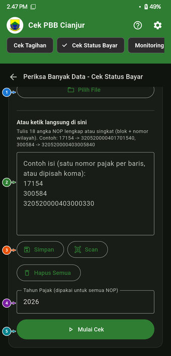
</p>

- Masukkan daftar NOP atau nomor wilayah secara beruntun.
- Sistem mengeksekusi pengecekan paralel dengan penanganan captcha otomatis.
- Rekapitulasi total tagihan, jumlah NOP lunas, dan sisa tunggakan disajikan dalam satu tabel terpadu.

---

### 3. Manajemen Data DHKP & Catatan Blok

Buku kerja digital bagi kolektor desa untuk mencatat realisasi lapangan, foto objek pajak, dan riwayat penagihan.

<p align="center">
  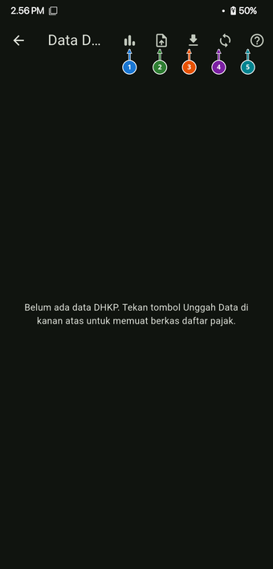
</p>

- **Filter 4 Metrik Instan**:
  - **Semua Data**: Menampilkan keseluruhan basis data DHKP blok wilayah kerja.
  - **Sudah Bayar**: Objek pajak yang telah terverifikasi lunas di BAPENDA.
  - **Belum Bayar**: Objek pajak dengan kewajiban pembayaran aktif.
  - **Target Pemda**: Objek pajak bernominal besar/prioritas pengawasan pemerintah daerah.
  - **Blacklist (≥ 5 Tahun)**: Objek pajak menunggak kronis lebih dari 5 tahun.
- **Pembaruan Lapangan**: Unggah foto objek/SPPT, beri catatan khusus kolektor, dan simpan status penagihan.
- **Ekspor Kolase Foto**: Penggabungan foto SPPT per blok ke dalam dokumen laporan PDF siap cetak.

---

### 4. Diagram Batang & Analitik Capaian DHKP Desktop Adaptif

Dashboard analitik visual untuk memantau performa penerimaan pajak se-desa atau per blok.

- **Mode Pas Layar (Dirapatkan)**: Pada layar desktop lebar ($\ge 800$ px), seluruh 41 blok se-desa otomatis dimuat pas 100% layar. Perbandingan performa antar-blok terlihat seketika dalam satu layar tanpa terpotong.
- **Mode Bisa Digeser (Scrollable)**: Dilengkapi dukungan interaksi mouse desktop:
  - **Klik & Seret (*Mouse Drag*)**: Klik kiri di mana saja pada grafik lalu geser horizontal.
  - **Roda Mouse (*Mouse Wheel*)**: Memutar roda mouse saat kursor di atas diagram otomatis menggulir horizontal.
  - **Scrollbar Horizontal**: Scrollbar interaktif yang dapat diseret dengan kursor.
- **Tombol Toggle Cepat**: Tombol **"Pas Layar" $\leftrightarrow$ "Bisa Digeser"** tersedia di Toolbar Kontrol dan Header Kartu Diagram.

---

### 5. Monitoring Wilayah & Portal Staf BAPENDA (MFA)

Modul administratif terotentikasi bagi staf desa/kelurahan yang memiliki akun portal resmi BAPENDA.

| Login Staf & Captcha | Verifikasi Google Authenticator MFA | Hub Menu Petugas |
| :---: | :---: | :---: |
| 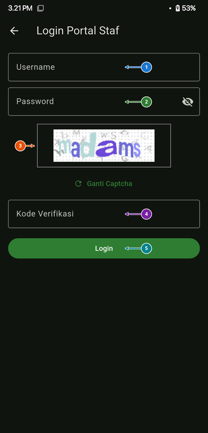 | 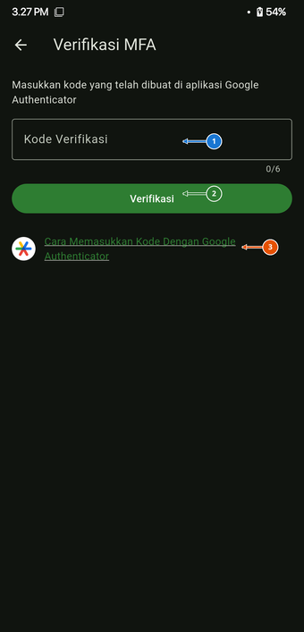 | 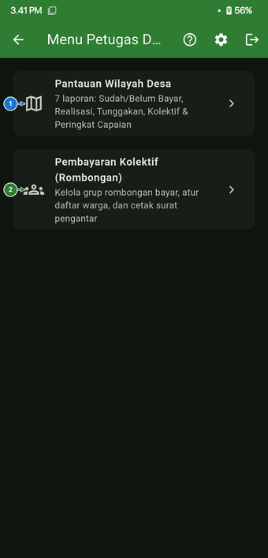 |

| Pantauan Realisasi Wilayah | Ranking Capaian Wilayah |
| :---: | :---: |
|  | 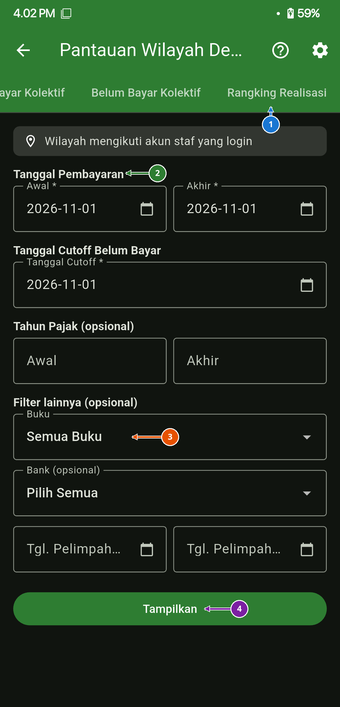 |

- **Autentikasi Dua Langkah**: Verifikasi kode TOTP Google Authenticator 6-digit dengan pintasan otomatis ke aplikasi autentikator.
- **7 Tab Rekap Wilayah**: *Sudah Bayar*, *Belum Bayar*, *Realisasi*, *Piutang*, *Kolektif Sudah Bayar*, *Kolektif Belum Bayar*, dan *Ranking Realisasi Wilayah*.

---

### 6. Pembayaran Kolektif & Surat Pengantar

Pengelolaan draf penagihan kolektif massal dan pencetakan surat pengantar pembayaran resmi.

| Daftar Grup Kolektif | Menu Aksi & Finalisasi | Kelola Anggota NOP |
| :---: | :---: | :---: |
| 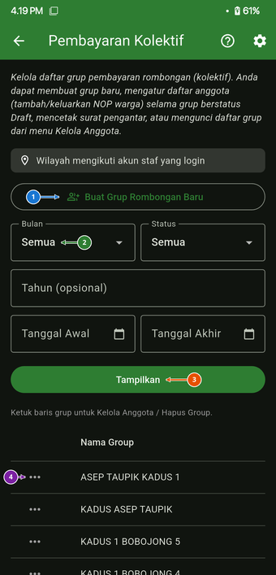 | 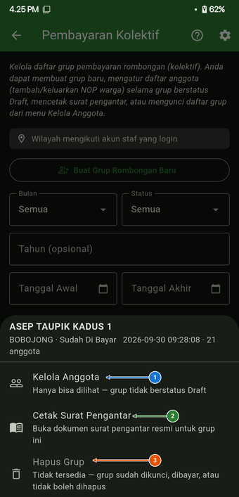 | 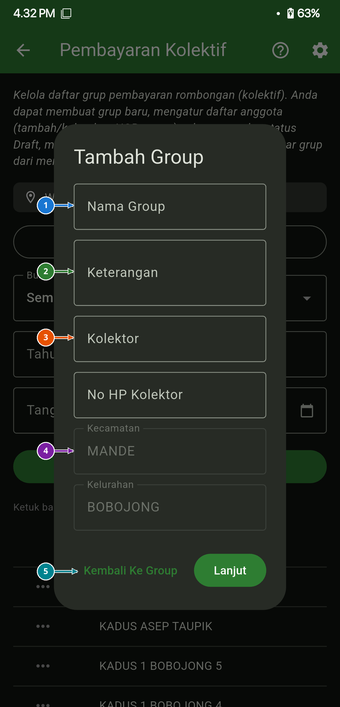 |

- Pembuatan grup penagihan baru per RT/RW atau Dusun.
- Impor massal anggota NOP dari berkas CSV/Excel.
- Finalisasi draf penagihan, penerbitan kode bayar kolektif, dan pencetakan Surat Pengantar Setoran.

---

### 7. Cek Pajak Kendaraan Bermotor (Jawa Barat)

Layanan terintegrasi untuk memeriksa kewajiban Pajak Kendaraan Bermotor (PKB) Samsat Jawa Barat.

<p align="center">
  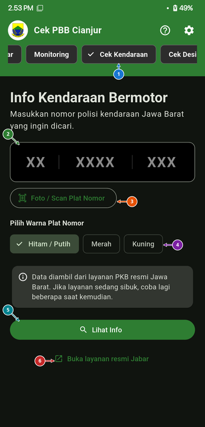
</p>

- Masukkan nomor polisi kendaraan dan pilih warna plat (Hitam/Putih, Kuning, Merah).
- Didukung fitur **Scan Plat Nomor (OCR Offline)** menggunakan kamera perangkat.
- Menyajikan rincian PKB Pokok, Denda, SWDKLLJ, PNBP STNK/TNKB, total bayar, dan tanggal jatuh tempo.

---

### 8. Cek Desil & Bantuan Sosial (Kemensos)

Verifikasi status ekonomi dan data kepesertaan bantuan sosial warga terpadu.

<p align="center">
  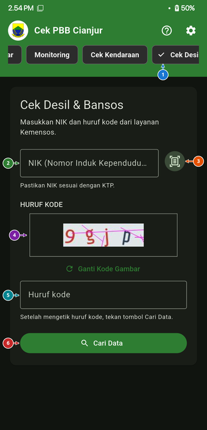
</p>

- Masukkan 16 digit NIK atau gunakan fitur **Scan NIK KTP/KK (OCR Offline)**.
- Menampilkan kategori desil kesejahteraan serta status keaktifan bansos: **Sembako / BPNT**, **Program Keluarga Harapan (PKH)**, **PBI-JK (BPJS Kesehatan Gratis)**, dan **KPD**.

---

### 9. Buku Panduan Penggunaan & Pusat Bantuan Interaktif

Modul edukasi visual mandiri yang memandu pengguna memahami seluruh fitur aplikasi secara rinci.

<p align="center">
  
</p>

- **19 Bab Layar Fitur Terpadu**: Dari pengecekan NOP, DHKP, monitoring staf, hingga pengaturan keamanan.
- **84 Titik Pin Interaktif**: Menunjukkan letak tombol dan fungsinya langsung pada gambar antarmuka asli.
- **Pencarian Cepat & Filter Kategori**: Temukan panduan fitur tertentu dalam hitungan detik.
- **Mode Layar Penuh & FAQ**: Pembesaran gambar beresolusi tinggi dan tanya-jawab seputar kendala umum.

---

### 10. Kustomisasi Tema, Keamanan & Pencadangan Data

Pengaturan kenyamanan visual, perlindungan privasi perangkat, dan pemulihan arsip data.

| Pengaturan Utama | Kustomisasi Tema & Warna | Keamanan Biometrik / PIN |
| :---: | :---: | :---: |
| 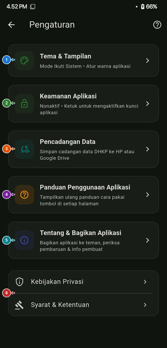 | 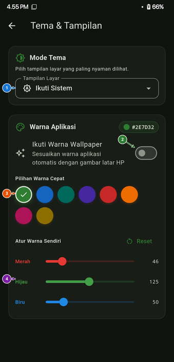 | 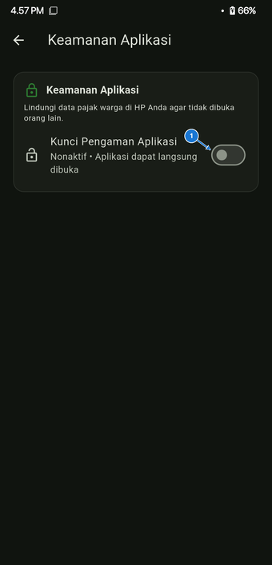 |

| Pencadangan & Pemulihan | Tentang Aplikasi & Profil |
| :---: | :---: |
| 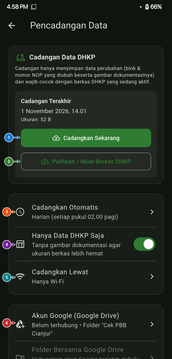 | 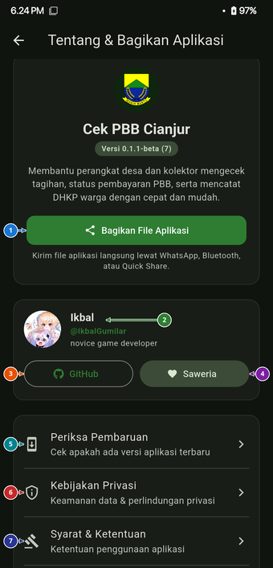 |

- **Kustomisasi Tema**: Pilihan mode Terang, Gelap, Hitam AMOLED, serta 8 warna aksen dinamis atau pemilih warna kustom.
- **Keamanan Aplikasi**: Penguncian otomatis berbasis Sidik Jari/Wajah, PIN 6-digit, atau Kata Sandi.
- **Pencadangan & Pemulihan**: Ekspor-impor berkas `.dkhp` terenkripsi AES-256-GCM, sinkronisasi Google Drive, dan cadangan otomatis pukul 02:00 dini hari.
- **Tentang Aplikasi**: Informasi versi, profil pengembang, tautan GitHub, donasi Saweria, dan pengecekan pembaruan.

---

## 🚀 Alur Pembaruan Otomatis

Aplikasi dilengkapi mekanisme pemantauan rilis yang terhubung langsung ke REST API GitHub:
1. Pengecekan otomatis berjalan maksimal sekali setiap 24 jam saat aplikasi dibuka, atau dapat dipicu manual melalui **Pengaturan → Tentang Aplikasi → Periksa Pembaruan**.
2. **Deteksi Versi SemVer Cerdas**: Mendukung pembaruan rilis stabil maupun versi uji coba (`beta` / `alpha`), dengan verifikasi nomor build (`+build`) dan proteksi dari berkas unduhan yang korup (`deleteOnError`).
3. **Pencocokan Arsitektur CPU (ABI-Aware APK)**: Pada Android, aplikasi mendeteksi arsitektur perangkat secara native (`Build.SUPPORTED_ABIS`) sehingga ponsel 64-bit modern otomatis mengunduh paket `arm64-v8a.apk`, ponsel 32-bit mengunduh `armeabi-v7a.apk`, dan emulator mengunduh `x86_64.apk`.
4. **Android**: Aplikasi mengunduh berkas `.apk` langsung ke cache privat, membuka installer sistem secara otomatis via `FileProvider`, dan menyediakan tombol buka ulang jika jendela konfirmasi sempat tertutup.
5. **Windows**: Mengunduh pembaruan dan secara otomatis mengeksekusi installer `.exe` baru atau mengekstrak paket portabel `.zip`.

---

## 🛠️ Panduan Pengembangan & Kompilasi

### Prasyarat
- Flutter SDK versi `>= 3.22.0`
- Dart SDK versi `>= 3.4.0`
- Android Studio / Android SDK Platform Tools (API 34)
- Visual Studio Community 2022 dengan C++ Desktop Development & Inno Setup 6/7 (khusus Windows)
- GCC / Clang, CMake, Ninja, dan `libgtk-3-dev` (khusus Linux Desktop)

### Langkah Kompilasi

1. **Kloning Repositori**:
   ```bash
   git clone https://github.com/IkbalGumilar/Cek-PBB-Cianjur.git
   cd Cek-PBB-Cianjur
   ```

2. **Pasang Dependensi**:
   ```bash
   flutter pub get
   ```

3. **Kompilasi Biner Rilis**:
   - **Android Split APK (Rekomendasi untuk efisiensi ukuran berkas)**:
     ```bash
     flutter build apk --release --split-per-abi
     ```
     Menghasilkan paket APK terpisah berdasarkan arsitektur CPU pada direktori `build/app/outputs/flutter-apk/`:
     - `app-arm64-v8a-release.apk` (~20 MB - Smartphone Android 64-bit modern)
     - `app-armeabi-v7a-release.apk` (~18 MB - Perangkat Android 32-bit legacy)
     - `app-x86_64-release.apk` (~22 MB - Emulator / Tablet Intel)
   - **Android Universal APK (Berkas gabungan seluruh ABI)**:
     ```bash
     flutter build apk --release
     ```
   - **Windows Desktop (Otomatis Portable ZIP + Installer Inno Setup EXE)**:
     Cukup jalankan satu skrip otomatis dari root proyek:
     ```cmd
     tool\build_windows.bat
     ```
     Atau kompilasi manual:
     ```cmd
     flutter build windows --release
     "C:\Program Files (x86)\Inno Setup 6\ISCC.exe" windows\installer.iss
     ```
     Hasil biner rilis:
     - `build\Cek-PBB-Cianjur-Setup-v0.1.4-beta.exe` (Installer Mandiri)
     - `build\Cek-PBB-Cianjur-Windows-x64-v0.1.4-beta.zip` (Portable ZIP)
   - **Linux Desktop**:
     ```bash
     flutter build linux --release
     ```
     Biner rilis dan pustaka pendukung dihasilkan di direktori `build/linux/x64/release/bundle/`.

> [!IMPORTANT]
> **Penandatanganan Rilis Android (Keystore)**  
> Kompilasi rilis Android membutuhkan konfigurasi berkas `android/key.properties` yang merujuk pada berkas keystore penandatanganan (`.jks`). Berkas ini tidak disertakan di dalam repositori publik demi menjaga integritas dan keamanan aplikasi.

---

## ⚖️ Pernyataan Privasi & Penafian

1. **Independensi Pengembang**: Aplikasi ini dikembangkan secara independen oleh pengembang sebagai alat bantu kerja operasional lapangan bagi petugas/kolektor desa di lingkungan Kabupaten Cianjur. Aplikasi ini bukan merupakan aplikasi resmi yang diterbitkan secara kelembagaan oleh Badan Pendapatan Daerah (BAPENDA) Kabupaten Cianjur.
2. **Kerahasiaan Data**: Seluruh pemrosesan teks, OCR dokumen, dan verifikasi NIK/NOP berlangsung secara luring (*on-device offline processing*) di perangkat masing-masing pengguna. Tidak ada data pribadi warga, dokumen KTP/KK, foto objek pajak, atau kata sandi yang dikirimkan ke peladen pihak ketiga selain transmisi resmi langsung ke portal BAPENDA dan Kemensos.
3. **Hak Cipta Layanan**: Hak cipta nama, logo daerah, serta infrastruktur portal layanan publik sepenuhnya merupakan milik Pemerintah Kabupaten Cianjur dan kementerian terkait.

---

## 📄 Lisensi

Proyek ini didistribusikan di bawah lisensi terbuka **GNU General Public License v3.0 (GPL-3.0)**. Lihat berkas [LICENSE](LICENSE) untuk ketentuan lengkapnya.
