# Cek PBB Cianjur

[](https://github.com/IkbalGumilar/Cek-PBB-Cianjur/releases/latest)
[](https://flutter.dev)
[](https://dart.dev)
[]()
[]()
[](LICENSE)

Aplikasi manajemen, pengecekan, monitoring, analisis realisasi, dan pelaporan Pajak Bumi dan Bangunan Perdesaan dan Perkotaan (PBB-P2) lintas platform untuk memfasilitasi kerja petugas/kolektor dan perangkat desa/kelurahan di seluruh **Kabupaten Cianjur** (**32 Kecamatan · 337 Desa/Kelurahan**). Aplikasi berkomunikasi langsung secara terenkripsi dengan portal layanan BAPENDA Kabupaten Cianjur, Bapenda Jawa Barat, dan Kemensos RI tanpa memerlukan navigasi manual di peramban web.

> [!NOTE]
> **Rilis Stabil Multi-Platform (`v1.0.0`)**  
> Tersedia di [GitHub Releases](https://github.com/IkbalGumilar/Cek-PBB-Cianjur/releases/latest) dalam bentuk **APK teroptimasi per arsitektur (*Split per ABI*, `20,1–21,2 MB`)** untuk Android, **Installer Mandiri Inno Setup (`16 MB`)** & **Portable (`.zip`, `19 MB`)** untuk Windows x64, arsip **Linux Desktop (`17 MB`)**, serta konfigurasi siap rilis **iOS (App Store)**.  
> Sistem pembaruan bawaan memverifikasi integritas berkas rilis menggunakan **checksum SHA-256** dan pemeriksaan **magic bytes** header biner sebelum instalasi dijalankan. Lihat rincian lengkap peningkatan di [`RELEASE_NOTES.md`](RELEASE_NOTES.md) dan [`CHANGELOG.md`](CHANGELOG.md).

---

## 📱 Galeri Perbandingan Antarmuka Mobile & Desktop

Antarmuka beradaptasi secara responsif (`AppBreakpoints`: Mobile `< 600dp`, Tablet `600–1023dp`, Desktop `>= 1024dp`) — ringkas dan nyaman disentuh di ponsel, sekaligus lapang dengan tabel multi-kolom, tata letak paralel, dan dukungan geser mouse/trackpad di komputer desktop.

<table>
  <thead>
    <tr>
      <th align="center" width="26%">📱 Tampilan Mobile (Android)</th>
      <th align="center" width="74%">🖥️ Tampilan Desktop (Linux / Windows)</th>
    </tr>
  </thead>
  <tbody>
    <tr>
      <td align="center">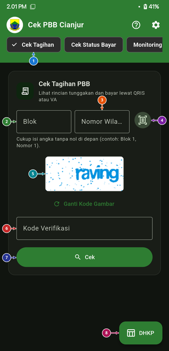<br /><sub><b>Beranda Cek Tagihan PBB-P2</b></sub></td>
      <td align="center">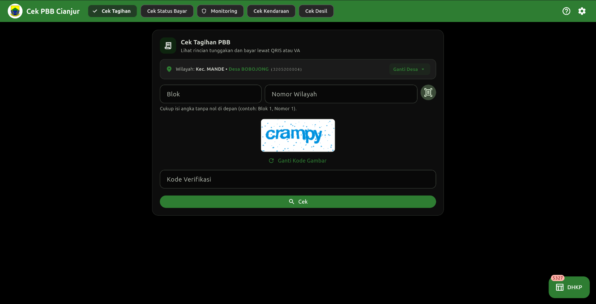<br /><sub><b>Beranda Desktop dengan Kartu Wilayah & Menu Layanan Terpadu</b></sub></td>
    </tr>
    <tr>
      <td align="center">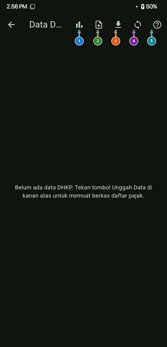<br /><sub><b>Buku Catatan DHKP di Ponsel</b></sub></td>
      <td align="center">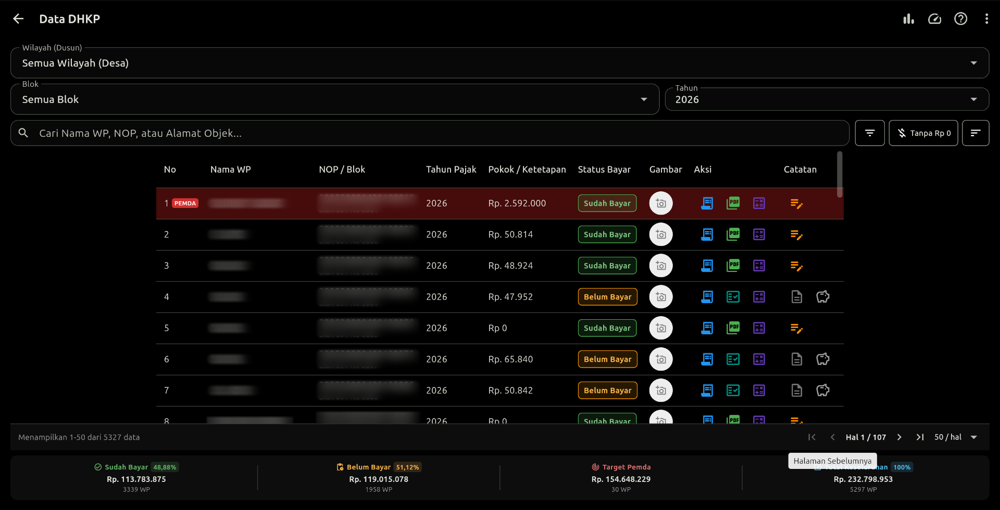<br /><sub><b>Manajemen Data DHKP Skala Ribuan NOP dengan KPI & Filter Instan</b></sub></td>
    </tr>
    <tr>
      <td align="center">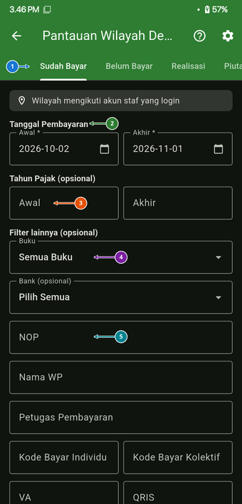<br /><sub><b>Pantauan Wilayah (7 Tab)</b></sub></td>
      <td align="center">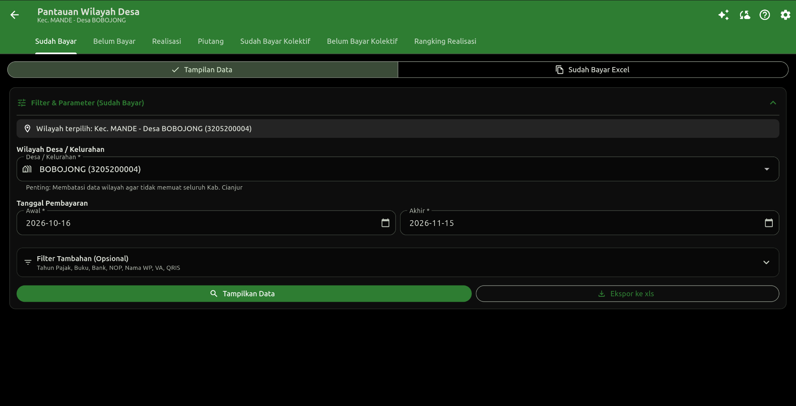<br /><sub><b>Pantauan Wilayah Desktop (Filter Lanjutan, Sinkronkan & Generate DHKP)</b></sub></td>
    </tr>
    <tr>
      <td align="center">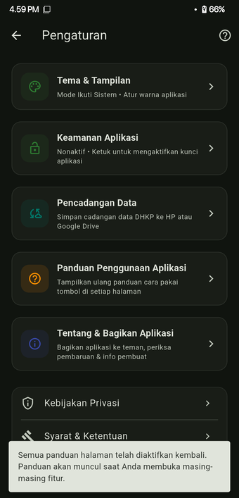<br /><sub><b>Buku Panduan Interaktif</b></sub></td>
      <td align="center">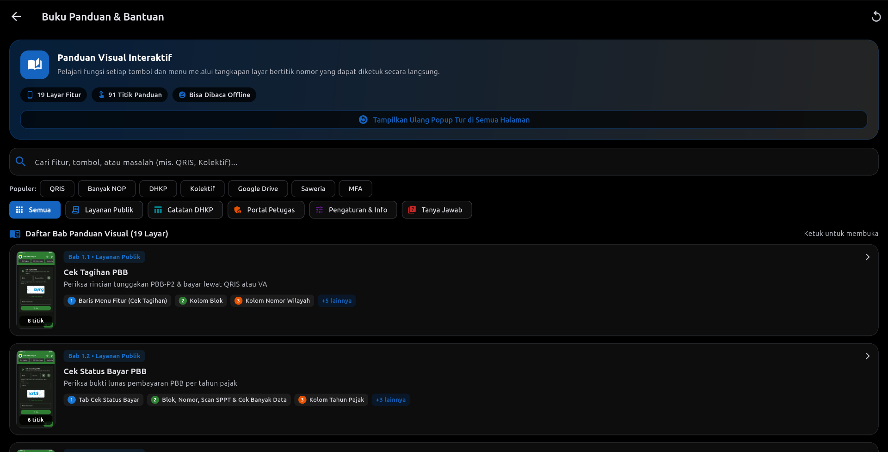<br /><sub><b>Buku Panduan (19 Layar Fitur · 91 Titik Panduan · Pan & Zoom)</b></sub></td>
    </tr>
  </tbody>
</table>

---

## 📑 Daftar Isi
- [Galeri Perbandingan Antarmuka Mobile & Desktop](#-galeri-perbandingan-antarmuka-mobile--desktop)
- [Fitur Utama](#-fitur-utama)
- [Desain Adaptif, Aksesibilitas & Sistem Gerak](#-desain-adaptif-aksesibilitas--sistem-gerak)
- [Arsitektur Keamanan & Kriptografi](#-arsitektur-keamanan--kriptografi)
- [Matriks Dukungan Platform](#-matriks-dukungan-platform)
- [Panduan Modul & Alur Kerja](#-panduan-modul--alur-kerja)
  - [1. Cek Tagihan, Status Bayar & Pembayaran Digital (QRIS / Virtual Account)](#1-cek-tagihan-status-bayar--pembayaran-digital-qris--virtual-account)
  - [2. Pemeriksaan Banyak NOP Sekaligus & Cek Massal Latar Belakang](#2-pemeriksaan-banyak-nop-sekaligus--cek-massal-latar-belakang)
  - [3. Manajemen Data DHKP, Kalkulator Pajak & Paket Laporan (.dat / .dkhp)](#3-manajemen-data-dhkp-kalkulator-pajak--paket-laporan-dat--dkhp)
  - [4. Diagram Capaian, Tren Pembayaran, Perbandingan Tahun & Pacing Target](#4-diagram-capaian-tren-pembayaran-perbandingan-tahun--pacing-target)
  - [5. Peta Spasial Objek Pajak DHKP (GIS & Poligon Wilayah)](#5-peta-spasial-objek-pajak-dhkp-gis--poligon-wilayah)
  - [6. Dukungan Multi-Wilayah se-Kabupaten Cianjur (32 Kecamatan · 337 Desa)](#6-dukungan-multi-wilayah-se-kabupaten-cianjur-32-kecamatan--337-desa)
  - [7. Portal Staf V-Tax, Login MFA TOTP, Sinkronisasi & Generate DHKP Baru (Split DKH2)](#7-portal-staf-v-tax-login-mfa-totp-sinkronisasi--generate-dhkp-baru-split-dkh2)
  - [8. Manajemen Pembayaran Kolektif & Surat Pengantar](#8-manajemen-pembayaran-kolektif--surat-pengantar)
  - [9. Cek Pajak Kendaraan Bermotor Jawa Barat (PKB)](#9-cek-pajak-kendaraan-bermotor-jawa-barat-pkb)
  - [10. Cek Desil & Status Bansos Kemensos](#10-cek-desil--status-bansos-kemensos)
  - [11. Pembaca PDF Camelot, Penampil Spreadsheet & Kolase Foto F4](#11-pembaca-pdf-camelot-penampil-spreadsheet--kolase-foto-f4)
  - [12. Buku Panduan Interaktif & Tur Fitur Langsung](#12-buku-panduan-interaktif--tur-fitur-langsung)
  - [13. Tema Adaptif, Keamanan Berlapis, Pencadangan & Legalitas](#13-tema-adaptif-keamanan-berlapis-pencadangan--legalitas)
- [Alur Pembaruan Otomatis](#-alur-pembaruan-otomatis)
- [Panduan Pengembangan & Kompilasi](#-panduan-pengembangan--kompilasi)
- [Pernyataan Privasi & Penafian](#-pernyataan-privasi--penafian)
- [Lisensi](#-lisensi)

---

## 🌟 Fitur Utama

1. **Layanan Informasi Pajak PBB-P2 Real-Time (`32.05` Cianjur)**:
   - Pengecekan rincian SPPT tahun berjalan, akumulasi tunggakan lintas tahun, denda otomatis, identitas Wajib Pajak, luas bumi/bangunan, serta kode **NOP 18 digit** tervalidasi otomatis pada awalan resmi Kabupaten Cianjur (`3205`).
   - Pembuatan tagihan **QRIS** dan **Virtual Account Bank bjb** langsung untuk pelunasan nontunai tanpa perlu berpindah aplikasi.
   - Pengunduhan dokumen **SPPT Digital** & **STTS PDF** resmi.
2. **Manajemen Data DHKP Skala Besar & Kalkulator Pajak Terpadu**:
   - Memuat ribuan baris data NOP (`BlokDataStore`) dari berkas Excel (`.xlsx`, `.xls`), CSV (`.csv`), maupun paket terenkripsi (`.dkhp`, `.dhkp`, `.dat`) baik dari penyimpanan lokal maupun **Tautan Google Drive** (lintas platform).
   - **3 Modul Kalkulator & Simulasi Keuangan** terintegrasi langsung per objek pajak maupun mandiri:
     - **Kalkulator Denda Pajak**: Membandingkan tarif bunga **1% per bulan (UU HKPD No. 1/2022)** vs **2% per bulan (aturan/Perda lama)** dengan batas maksimal **24 bulan** beserta rincian bulan terlambat.
     - **Kalkulator Cicilan / Tabungan Warga**: Mencatat setoran celengan pajak, riwayat mutasi, penandatanganan digital Wajib Pajak (*kanvas TTD*), simulasi angsuran (Harian / Mingguan / Bulanan), serta mendeteksi status *Lunas* dan sisa lebih dana warga secara otomatis.
     - **Kalkulator AJB & Simulasi NJOP**: Menghitung proyeksi transaksi nilai jual tanah (`luas × NJOP/m²`), estimasi **PPh (2,5%)**, **PPN (2,5%)**, serta pengecekan otomatis ambang **BPHTB (5% jika nilai transaksi $\ge$ Rp 80.000.000)**.
   - **Target & Pacing Realisasi**: Simulasi target capaian persentase wilayah, estimasi jumlah NOP tersisa yang perlu ditagih, dan kecepatan target setoran harian/mingguan menuju jatuh tempo.
3. **Analitik Grafik Interaktif & Pemetaan Spasial GIS**:
   - **5 Kategori Analisis Grafik** (`Jumlah Persentase`, `Jumlah Pendapatan`, `Belum Bayar`, `Sudah Bayar`, dan `Tren Pembayaran Jan–Des`), **4 Gaya Diagram** (`Batang`, `Mendatar`, `Lingkaran`, `Semua`), mode **Bandingkan Tahun**, drill-down **Semua Dusun / per Dusun / per Desa**, serta mode tampilan blok (**Top 5 Tertinggi**, **5 Terendah**, **Pilih Blok**).
   - **Peta Spasial Objek Pajak** berbasis `flutter_map` & `latlong2` dengan **5 pilihan layer peta** (Google Satelit Hybrid, Google Satelit Foto Udara Murni, Google Peta Jalan, OpenStreetMap, dan Peta Rupabumi Indonesia BIG), pencatatan pin GPS multi-NOP (`MapPinStore`), zona kedusunan, serta ekspor/impor **KML**.
4. **Portal Staf V-Tax terpadu (Monitoring, Sinkronkan, & Generate DHKP `DKH2`)**:
   - Login portal internal `cianjurkab.v-tax.id` dengan bantuan pengenalan **Captcha OCR** otomatis dan **Autentikasi 2 Faktor TOTP (RFC 6238)** untuk kode 6 digit sekali ketuk.
   - **7 Tab Pantauan Wilayah** lengkap: `Sudah Bayar`, `Belum Bayar`, `Realisasi`, `Piutang`, `Sudah Bayar Kolektif`, `Belum Bayar Kolektif`, dan `Rangking Realisasi`, dilengkapi tombol **Sinkronkan DHKP** dan **Generate DHKP Baru** (penarikan histori 2015–tahun berjalan dari V-Tax, pemetaan blok ke dusun & koordinat, lalu **Pecah & Enkripsi Paket `.dkhp` per Dusun + Master Desa** format `DKH2`).
   - **Pembayaran Kolektif & Kelola Anggota**: Kelola daftar grup kolektif, penambahan NOP tunggal maupun massal via berkas CSV/Excel/Teks, sinkronisasi otomatis anggota saat grup pertama dibuka, serta pencetakan **Surat Pengantar PDF** dan ekspor data grup.
5. **Pembaca PDF Camelot, Penampil Spreadsheet & Layanan Tambahan**:
   - **Pembaca PDF Camelot** internal dengan lapisan teks dapat dipilih (*Selectable Text Layer* — drag di Android / mouse + `Ctrl+C` di Desktop), zoom *double-tap* / `Ctrl+Scroll`, *fast-scroll scrubber*, serta **cetak langsung ke driver printer OS (`Ctrl+P`)** di Desktop.
   - **Penampil Spreadsheet** bawaan untuk `.xlsx`/`.xls`/`.csv` (*Hanya Lihat*) dan pratinjau paket `.dkhp`/`.dhkp`/`.dat` dengan tombol langsung **"Impor ke Buku Catatan"**.
    - **Kolase Foto Dokumentasi PDF F4** (tata letak `1x2` s.d. `3x3`), **Checkpoint Pause/Resume 24 Jam** untuk Cek Massal & Sinkronisasi DHKP latar belakang, serta **Pencadangan Delta `.dat`** terenkripsi.
    - Layanan publik pelengkap: **Cek Pajak Kendaraan Bermotor Jawa Barat (Sambara Bapenda Jabar)** dengan visual plat dinamis & deteksi plat luar Jawa Barat, serta **Cek Desil Kesejahteraan & Bansos (DTSEN Kemensos `cb-v4`)** dengan pemuatan captcha otomatis setelah 12 digit NIK.
6. **Kontak Darurat Kabupaten Cianjur (`112`) & Sinkronisasi Akun Google (`appDataFolder`)**:
    - Tombol mengambang **`112`** khusus perangkat seluler (Android & iOS) di seluruh tab utama untuk akses cepat ke **Cianjur Siaga 112**, **Polres Cianjur**, **BPBD Cianjur** (WhatsApp & Telepon), **PSC 119 / RSUD Sayang**, **PLN 123**, **6 Pos Damkar Cianjur**, **SP4N-LAPOR! (`lapor.go.id`)**, serta **Kontak Darurat Lokal/Desa** (Bidan Desa, Kepala Desa, Bhabinkamtibmas, Babinsa, Ambulans Desa).
    - Sinkronisasi lintas perangkat melalui Google Drive `appDataFolder` (Master Key 256-bit, Tema, Jadwal Backup, & Kontak Darurat Lokal) dengan dukungan penuh **Google OAuth 2.0 Desktop (`127.0.0.1` loopback)** di Windows & Linux.

---

## 🎨 Desain Adaptif, Aksesibilitas & Sistem Gerak

- **Breakpoint Responsif (`AppBreakpoints`)**: Tata letak otomatis menyesuaikan lebar layar menjadi mode **Mobile (`< 600dp`)**, **Tablet (`600–1023dp`)**, dan **Desktop (`>= 1024dp`)**. Filter panjang dikemas dalam komponen lipat (*Progressive Disclosure* `AppCollapsibleFilterSection`) berindikator filter aktif agar layar ponsel tidak sesak.
- **Ergonomi Desktop (`AppScrollBehavior` & `AppHorizontalTableScroll`)**: Mendukung klik-seret (*mouse/trackpad drag*) pada tabel dan grafik batang, scrollbar horizontal interaktif, pintasan papan ketik `Ctrl+P` / `Ctrl+C`, dukungan penuh DPI `PerMonitorV2` (Windows), serta stabilitas *fractional scaling* Linux (`GDK_BACKEND=x11`).
- **Sistem Tema & Material You (`ThemeController`)**: 4 mode tampilan (**Ikuti Sistem**, **Terang**, **Gelap**, dan **Hitam AMOLED `#000000`**), pemilihan **Warna Aksen Kustom** yang terpadu hingga ke seluruh grafik DHKP, serta dukungan warna dinamis **Material You** pada Android 12+.
- **Sistem Gerak Halus & Aksesibilitas (`AppMotion` & `unity_lerp_widgets.dart`)**: Transisi halaman seragam dan animasi progres angka, bar grafik, maupun diagram tren memakai interpolasi halus (`unityLerp`, `unitySmoothStep`, `unitySmoothDamp`), serta secara otomatis menghormati preferensi aksesibilitas **Kurangi Animasi / Reduced Motion** (`MediaQuery.maybeDisableAnimationsOf`).

---

## 🛡️ Arsitektur Keamanan & Kriptografi

- **Enkripsi Arsip DHKP V2 (`DKH2` — `lib/dhkp/dhkp_crypto.dart`)**: Paket `.dkhp` dilindungi menggunakan **AES-256-GCM** dengan derivasi kunci **PBKDF2-HMAC-SHA256 sebanyak `600.000` iterasi**, *16-byte random salt*, *12-byte random nonce*, *32-byte header AAD*, dan *16-byte GCM authentication tag*. Mendukung **Kata Sandi Backup** terintegrasi maupun kata sandi kustom (minimal **8 karakter**), sembari menjaga kompatibilitas baca terhadap berkas arsip versi lama.
- **Sinkronisasi Cloud & OAuth Non-Sensitive (`GoogleAccountSyncService`)**: Menggunakan *non-sensitive scopes* (`drive.file` & `drive.appdata`) tanpa izin baca seluruh Google Drive pengguna. Master Key cadangan 256-bit dan preferensi (`app_preferences.json`) disimpan terisolasi di ruang tersembunyi `appDataFolder` dan `FlutterSecureStorage`.
- **Zero-Persistence & Auto-Clear Memori**: Data input & hasil **Cek Desil (NIK)** serta **Cek Kendaraan (Plat Nomor)** tidak pernah disimpan ke penyimpanan lokal maupun cloud, dan otomatis dibersihkan dari memori saat berpindah tab, masuk Setelan, atau saat aplikasi diminimize/ditutup — tanpa mengganggu proses Cek Massal & Sinkronisasi DHKP.
- **Kunci Aplikasi & Penyimpanan Kredensial Aman (`AppSecurityService`)**:
  - Mendukung kunci **Sidik Jari / Biometrik / Kunci Perangkat**, **PIN 6 Angka**, dan **Kata Sandi** dengan *PBKDF2 `100.000` iterasi*.
  - Seluruh hash kredensial, token sesi, rahasia TOTP (`StaffAuthenticatorStore`), dan *Kata Sandi Cadangan* (`BackupPasswordStore`) disimpan di **`FlutterSecureStorage`** / keyring terenkripsi platform — tidak pernah disalin ke `SharedPreferences` teks biasa. Konfigurasi Android menetapkan `android:allowBackup="false"`.
  - Dilengkapi **Exponential Backoff Lockout**: kegagalan otentikasi ke-5 memicu jeda **30 detik**, ke-6 **60 detik**, ke-7 **120 detik**, ke-8 **240 detik**, hingga maksimal **30 menit (1800 detik)** (tidak tereset sebelum verifikasi berhasil).
- **Perlindungan Data & Pembaruan Biner**:
  - Sanitasi otomatis karakter formula spreadsheet (`=`, `+`, `-`, `@`, tab, newline) pada seluruh ekspor CSV/laporan (`BaseTableExporter`, `BlokCsvCodec.encodeReportCsv`), serta *XML & CDATA escaping* pada ekspor KML.
  - Pencegahan *Open Redirect* di `StaffPortalClient` (`normalizeRedirectLocation`), validasi path/ID tautan Google Drive, pemblokiran API geolokasi IP non-HTTPS, dan pemeriksaan batas ukuran PDF (`<= 150 MB`) + magic bytes `%PDF-`.
  - Mekanisme *Self-Updater* memverifikasi **SHA-256 checksum** serta **magic bytes** header biner unduhan ke berkas sementara `.part` dan menghapus berkas secara otomatis bila verifikasi gagal.

---

## 💻 Matriks Dukungan Platform

| Fitur & Kapabilitas | Android | iOS | Windows (`x64`) | Linux Desktop | Catatan Teknis |
| :--- | :---: | :---: | :---: | :---: | :--- |
| Cek Tagihan, Status Bayar, QRIS, VA, STTS, Cek PKB & Desil | ✅ | ✅ | ✅ | ✅ | Komunikasi HTTPS langsung ke portal resmi |
| Data DHKP (Tabel Ribuan Data, Filter, Export, Split `DKH2`) | ✅ | ✅ | ✅ | ✅ | Komponen responsif + mouse drag tabel/grafik |
| Kalkulator Pajak (Denda, Cicilan/TTD WP, AJB & Pacing) | ✅ | ✅ | ✅ | ✅ | Perhitungan lokal + kanvas tanda tangan sentuh/mouse |
| Diagram Capaian, Tren Jan–Des & Bandingkan Tahun | ✅ | ✅ | ✅ | ✅ | Warna grafik seragam tema aktif + animasi `Lerp` |
| Peta Spasial Objek Pajak (`flutter_map` & KML) | ✅ | ✅ | ✅ | ✅ | 5 layer peta + koordinat pin `MapPinStore` |
| Portal Staf V-Tax (MFA TOTP, Monitoring 7 Tab, Kolektif) | ✅ | ✅ | ✅ | ✅ | Auto-TOTP & manajemen grup kolektif lengkap |
| Sinkronisasi & Generate DHKP Baru V-Tax (`DKH2`) | ✅ | ✅ | ✅ | ✅ | Checkpoint pause/resume 24 jam + pecah per dusun |
| Pembaca PDF Camelot & Penampil Spreadsheet | ✅ | ✅ | ✅ | ✅ | Desktop mendukung Cetak Driver OS langsung (`Ctrl+P`) |
| Login Akun Google, Pencadangan Drive & `appDataFolder` Sync | ✅ | ✅ | ✅ | ✅ | OAuth Desktop via loopback `127.0.0.1` (`env.desktop.json`) |
| Tombol Kontak Darurat `112` Cianjur & Kontak Desa | ✅ | ✅ | — | — | Khusus perangkat seluler (panggil/WA 1-ketuk + sync Google) |
| Pemindaian Kamera OCR (NOP / KTP / Plat) & AppWidget Home | ✅ | ✅ | — | — | Google ML Kit di HP (*AppWidget & Foreground Service khusus Android) |
| Pembaruan Mandiri (*Self-Updater* GitHub Releases) | ✅ | — | ✅ | ✅ | Verifikasi SHA-256 & magic header (iOS melalui App Store) |

---

## 📖 Panduan Modul & Alur Kerja

### 1. Cek Tagihan, Status Bayar & Pembayaran Digital (QRIS / Virtual Account)

Modul layanan cepat untuk memeriksa SPPT PBB-P2 Kabupaten Cianjur berdasarkan **NOP (18 digit)** dengan prefill otomatis kode **Kecamatan & Desa kerja aktif** (`32.05.xxx.xxx`).

<table>
  <thead>
    <tr>
      <th align="center" width="26%">📱 Tampilan Mobile</th>
      <th align="center" width="74%">🖥️ Tampilan Desktop</th>
    </tr>
  </thead>
  <tbody>
    <tr>
      <td align="center"><br /><sub><b>Form Cek Tagihan (Mobile)</b></sub></td>
      <td align="center">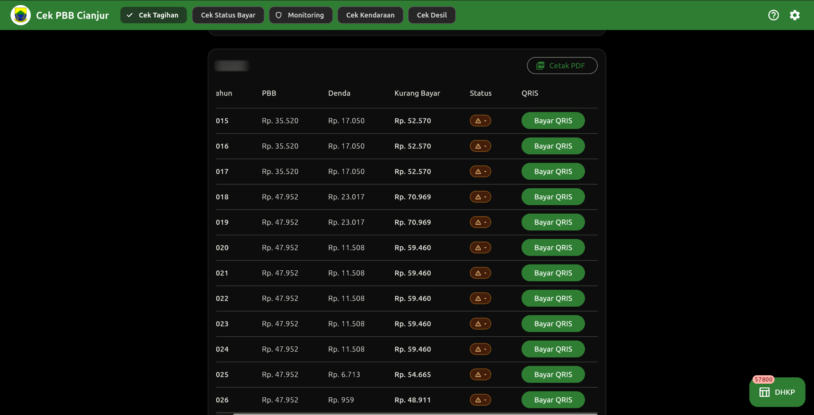<br /><sub><b>Hasil Rincian Pokok, Denda, Tunggakan Lintas Tahun & Tombol Aksi (Desktop)</b></sub></td>
    </tr>
    <tr>
      <td align="center">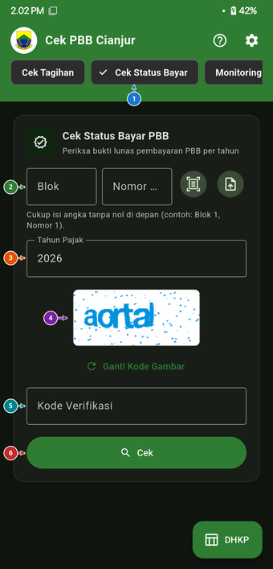<br /><sub><b>Form Cek Status Bayar (Mobile)</b></sub></td>
      <td align="center">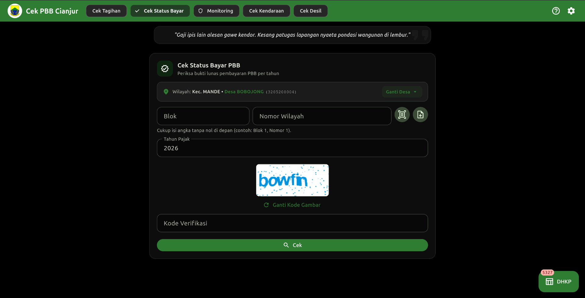<br /><sub><b>Cek Status Pelunasan & Tahun Pajak Spesifik (Desktop)</b></sub></td>
    </tr>
  </tbody>
</table>

- **QRIS Dinamis, Virtual Account & Pilih Wilayah Instan**: Tagihan berjalan maupun tunggakan dapat langsung dibuatkan kode QRIS / VA Bank bjb, sedangkan ganti kecamatan/desa sementara dapat dilakukan lewat tombol pemilih wilayah di form utama.

<details>
<summary><b>📸 Lihat Detail Pembayaran QRIS & Pemilih Desa Cepat (Desktop)</b></summary>
<br />
<table>
  <tr>
    <td align="center" width="50%">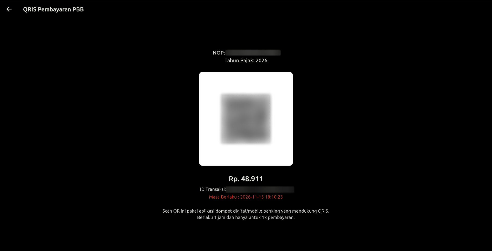<br /><sub><b>Tampilan Kode Bayar QRIS & Masa Berlaku</b></sub></td>
    <td align="center" width="50%">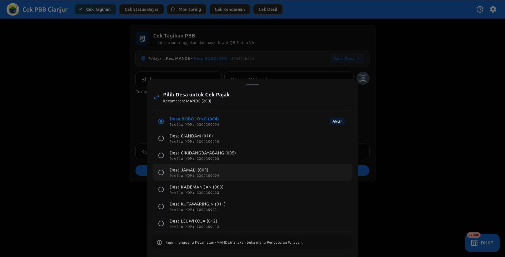<br /><sub><b>Bottom Sheet Pemilihan Kecamatan & Desa Cianjur</b></sub></td>
  </tr>
</table>
</details>

---

### 2. Pemeriksaan Banyak NOP Sekaligus & Cek Massal Latar Belakang

Fitur **Periksa Banyak Data (Banyak NOP)** mendukung pemasukan banyak NOP secara baris per baris, penempelan teks (*paste*), atau impor berkas **Excel/CSV** dengan indikator antrean paralel dan pengunduhan bukti **STTS PDF**.

<table>
  <thead>
    <tr>
      <th align="center" width="26%">📱 Tampilan Mobile</th>
      <th align="center" width="74%">🖥️ Tampilan Desktop</th>
    </tr>
  </thead>
  <tbody>
    <tr>
      <td align="center">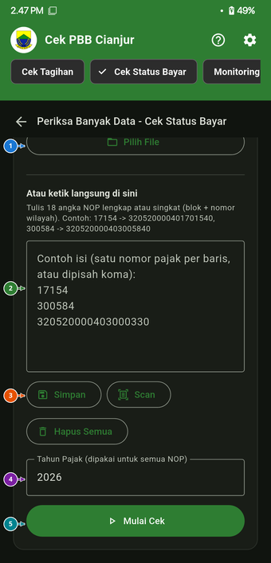<br /><sub><b>Impor & Antrean Banyak NOP (Mobile)</b></sub></td>
      <td align="center">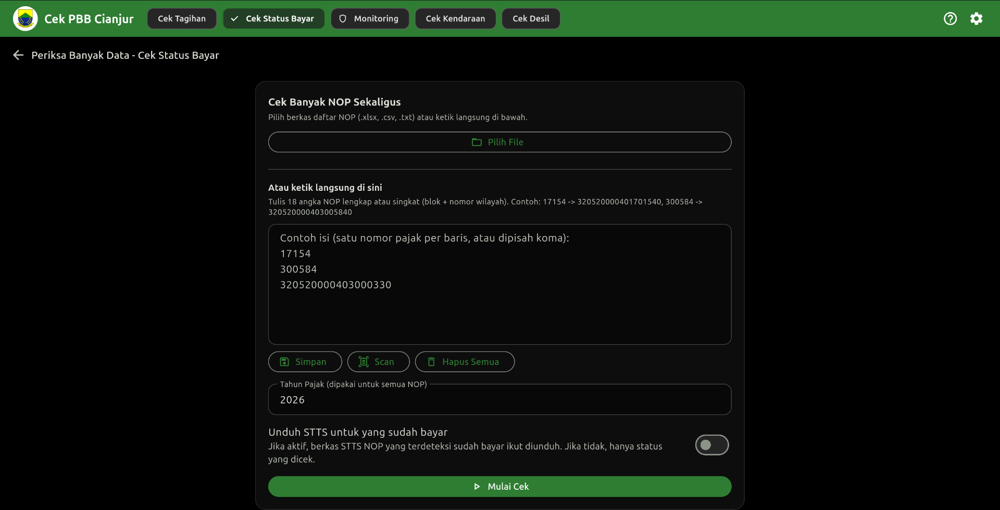<br /><sub><b>Pengecekan Multi-NOP Desktop dengan Ringkasan Lunas / Belum Bayar</b></sub></td>
    </tr>
  </tbody>
</table>

- **Arsip Hasil & Delta Download STTS**: Saat dijalankan pada Buku Catatan DHKP, berkas STTS PDF otomatis diunduh **hanya untuk NOP berstatus Lunas** ke folder bertanggal per blok (`Blok_<nomor>/`), dilengkapi berkas ringkasan `INFORMASI_BLOK_<nomor>.txt` dan paket `.zip`.

---

### 3. Manajemen Data DHKP, Kalkulator Pajak & Paket Laporan (.dat / .dkhp)

Buku Catatan DHKP mengelola ribuan data objek pajak secara luring maupun sinkron, dilengkapi kartu metrik pelunasan, penyaringan (*Sudah Bayar*, *Belum Bayar*, *Target Pemda*, *Sembunyikan Rp 0*, status *Blacklist*), serta pencatatan **status bayar, catatan lapangan, foto bukti serah terima SPPT**, dan **menu aksi kanan atas** yang komprehensif.

<table>
  <thead>
    <tr>
      <th align="center" width="26%">📱 Tampilan Mobile</th>
      <th align="center" width="74%">🖥️ Tampilan Desktop</th>
    </tr>
  </thead>
  <tbody>
    <tr>
      <td align="center"><br /><sub><b>Daftar & Ringkasan Blok DHKP (Mobile)</b></sub></td>
      <td align="center">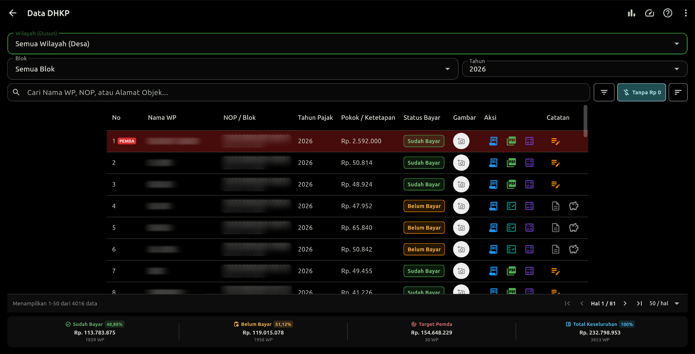<br /><sub><b>Tabel Interaktif DHKP Desktop dengan Filter Aktif & Aksi Kalkulator/Peta/Ekspor</b></sub></td>
    </tr>
  </tbody>
</table>

#### 🔹 Unggah Berkas, Unduhan Tautan Google Drive & Cek Massal Per Blok
Petugas dapat memuat data dari berkas lokal (`.xlsx`, `.xls`, `.csv`, `.dkhp`, `.dhkp`, `.dat`) atau memasukkan **Tautan Berbagi Google Drive** untuk mengunduh & menggabungkan paket secara langsung, serta menjalankan **Cek Status Bayar Massal** terhadap blok tertentu dengan laporan akhir terperinci.

<details>
<summary><b>📸 Galeri Lengkap Manajemen DHKP: Menu Aksi, Blacklist, Tautan Google Drive & Cek Massal (Desktop)</b></summary>
<br />
<table>
  <tr>
    <td align="center" width="50%">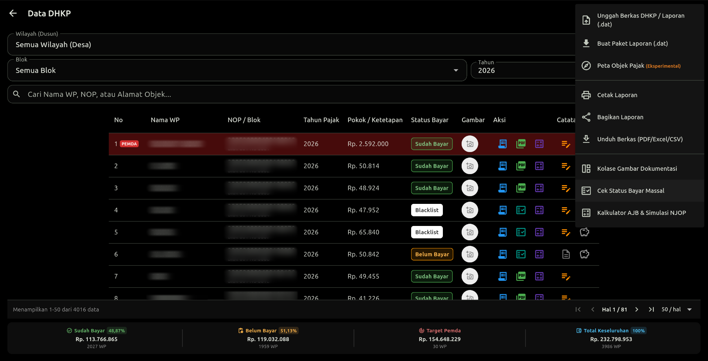<br /><sub><b>Menu Aksi Lengkap: Laporan .dat, Peta, Cetak, Kolase & AJB</b></sub></td>
    <td align="center" width="50%">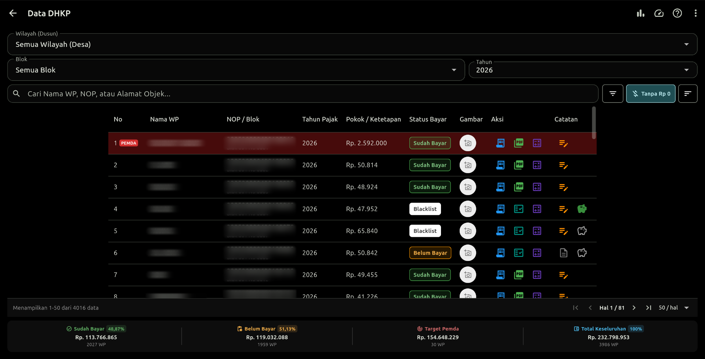<br /><sub><b>Tampilan Filter & Status Khusus (Blacklist / Target Pemda)</b></sub></td>
  </tr>
  <tr>
    <td align="center">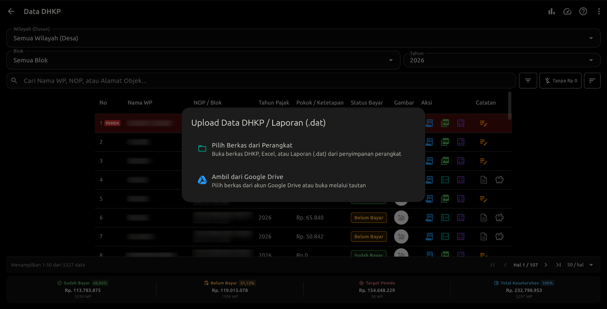<br /><sub><b>Pilihan Sumber Unggah Berkas DHKP / Paket Laporan</b></sub></td>
    <td align="center">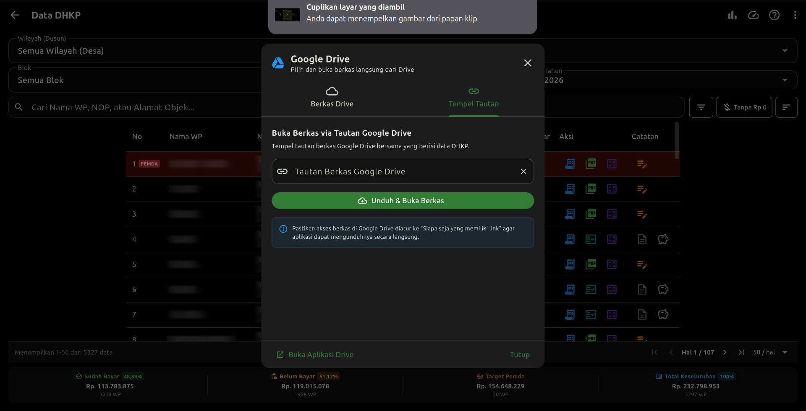<br /><sub><b>Input Tautan Google Drive Lintas Platform</b></sub></td>
  </tr>
  <tr>
    <td align="center">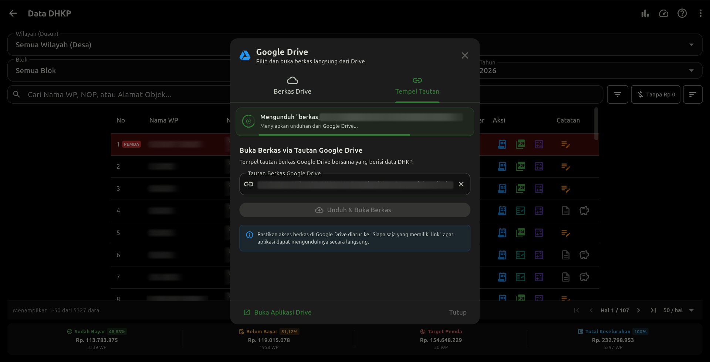<br /><sub><b>Progres Pengunduhan Paket dari Tautan Google Drive</b></sub></td>
    <td align="center">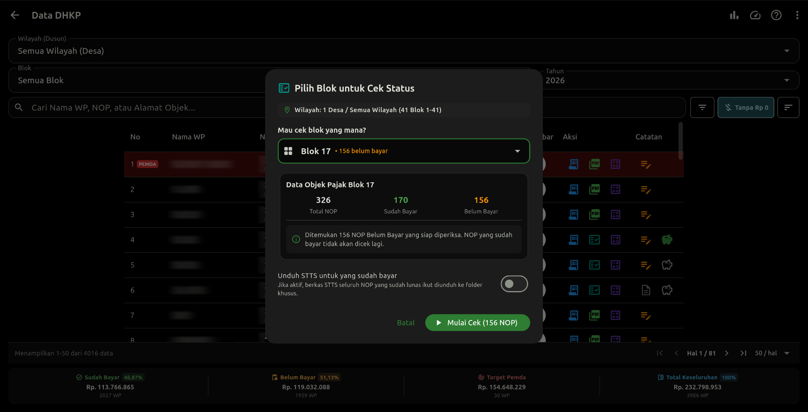<br /><sub><b>Pemilihan Blok untuk Cek Status Massal DHKP</b></sub></td>
  </tr>
  <tr>
    <td align="center">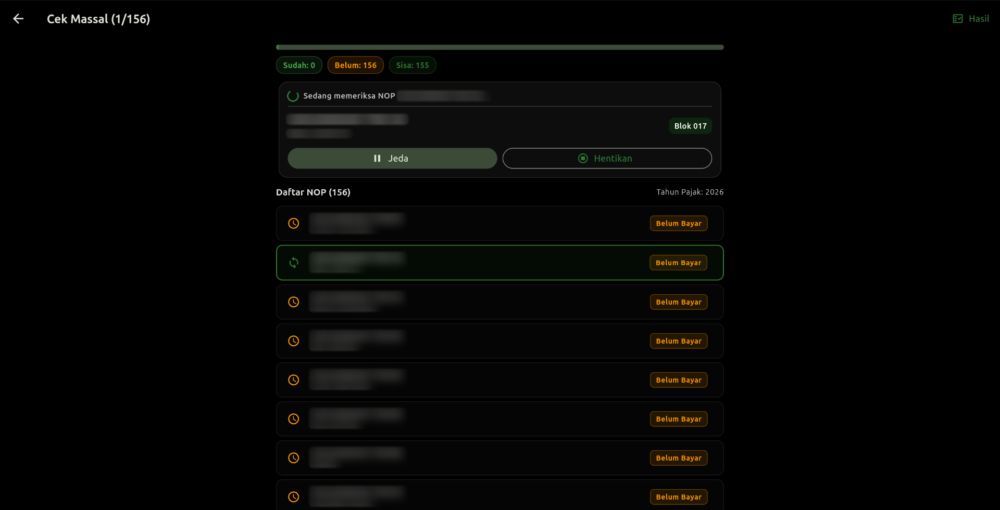<br /><sub><b>Pemantauan Antrean Cek Status Massal Real-Time</b></sub></td>
    <td align="center">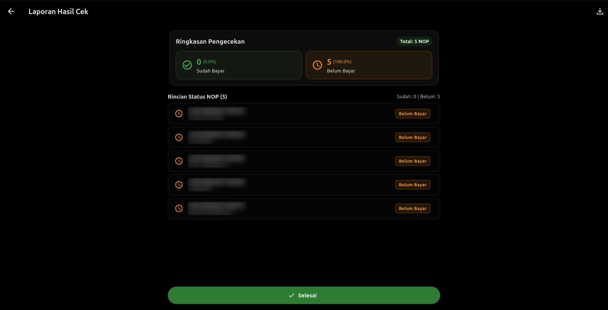<br /><sub><b>Laporan Hasil Akhir Pelunasan Baru & Kegagalan</b></sub></td>
  </tr>
</table>
</details>

#### 🔹 Kalkulator Denda, Cicilan/Celengan Warga, Simulasi AJB & Target Pacing Realisasi
Langsung dari tiap baris objek pajak maupun menu utama DHKP, petugas dan warga dapat menyimulasikan denda keterlambatan (**1% UU HKPD** vs **2% Perda Lama**), mencatat tabungan cicilan dengan **tanda tangan digital WP**, menghitung pajak jual-beli tanah (**PPh, PPN, BPHTB $\ge$ Rp 80 Juta**), serta menghitung **Target & Pacing Setoran Harian/Mingguan**.

<details>
<summary><b>📸 Galeri Kalkulator Denda, Cicilan Warga & Target Pacing Realisasi (Desktop)</b></summary>
<br />
<table>
  <tr>
    <td align="center" width="50%">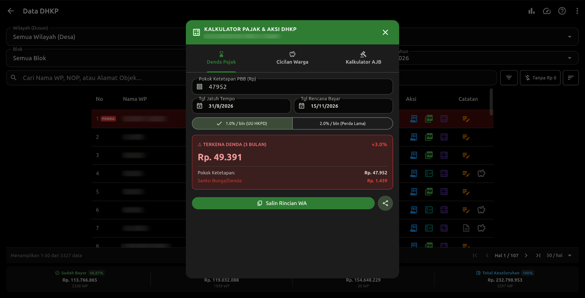<br /><sub><b>Kalkulator Denda Keterlambatan PBB-P2 (Tarif 1% vs 2%)</b></sub></td>
    <td align="center" width="50%">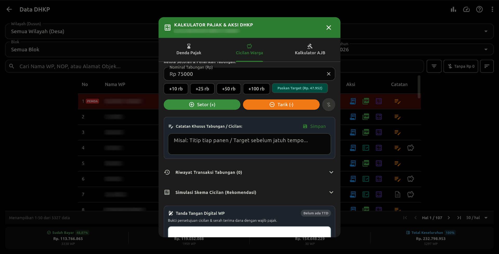<br /><sub><b>Input Setoran Tabungan/Cicilan Warga & Tanda Tangan WP</b></sub></td>
  </tr>
  <tr>
    <td align="center">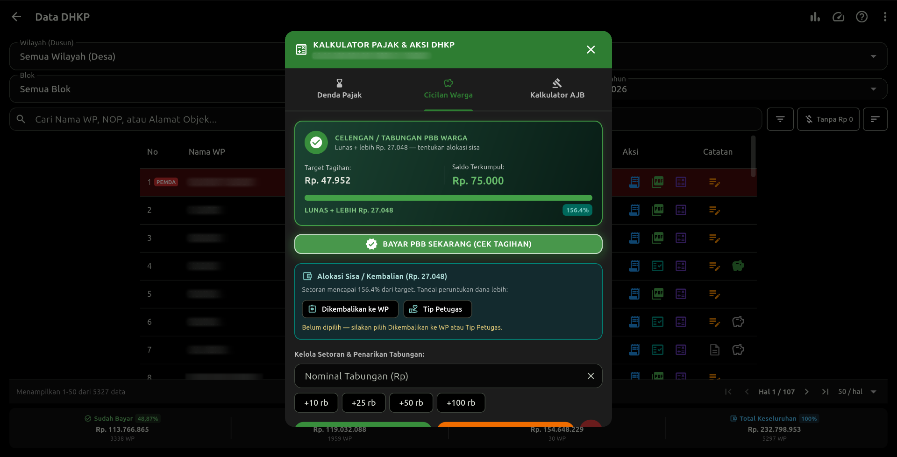<br /><sub><b>Deteksi Otomatis Status Lunas & Sisa Lebih Dana Warga</b></sub></td>
    <td align="center">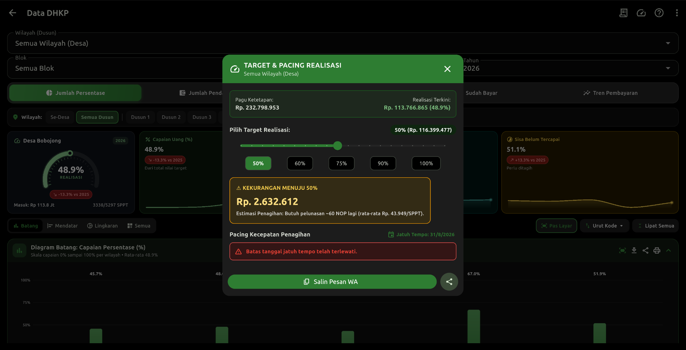<br /><sub><b>Simulasi Target Realisasi & Pacing Harian/Mingguan</b></sub></td>
  </tr>
</table>
</details>

---

### 4. Diagram Capaian, Tren Pembayaran, Perbandingan Tahun & Pacing Target

Visualisasi data realisasi DHKP dengan **animasi interpolasi `Lerp` yang halus**, **5 tab kategori data** (`Jumlah Persentase`, `Jumlah Pendapatan`, `Belum Bayar`, `Sudah Bayar`, `Tren Pembayaran`), **4 gaya grafik** (`Batang`, `Mendatar`, `Lingkaran`, `Semua`), drill-down klik langsung ke dusun/blok/desa, dan **perbandingan multi-tahun**.

<table>
  <tr>
    <td align="center" width="50%">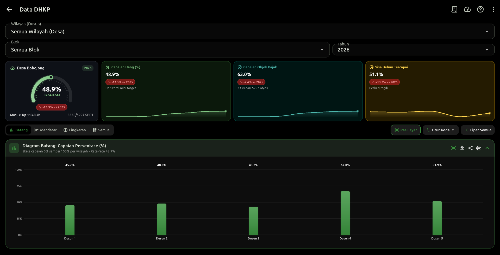<br /><sub><b>Diagram Batang Persentase Capaian & Semi-Circular Gauge</b></sub></td>
    <td align="center" width="50%">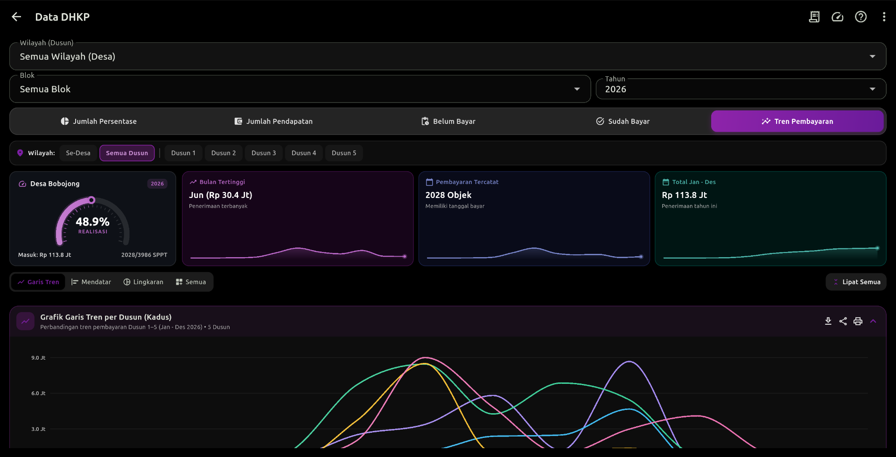<br /><sub><b>Grafik Tren Pembayaran Bulanan (Januari–Desember)</b></sub></td>
  </tr>
</table>

<details>
<summary><b>📸 Galeri Analisis Tren Lanjutan & Perbandingan Antar Tahun (Desktop)</b></summary>
<br />
<table>
  <tr>
    <td align="center" width="50%">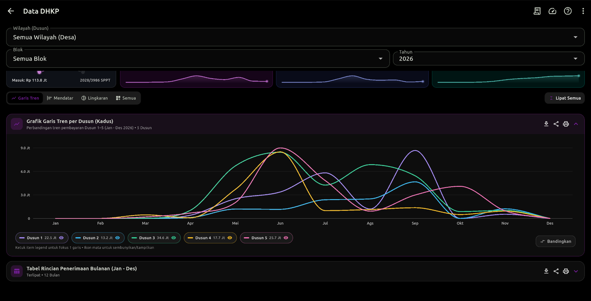<br /><sub><b>Analisis Garis Tren Realisasi per Wilayah Dusun</b></sub></td>
    <td align="center" width="50%">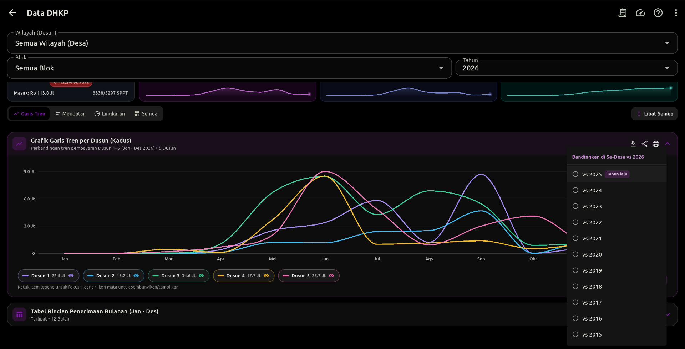<br /><sub><b>Menu Pemilihan Tahun Pembanding Data DHKP</b></sub></td>
  </tr>
  <tr>
    <td align="center" colspan="2">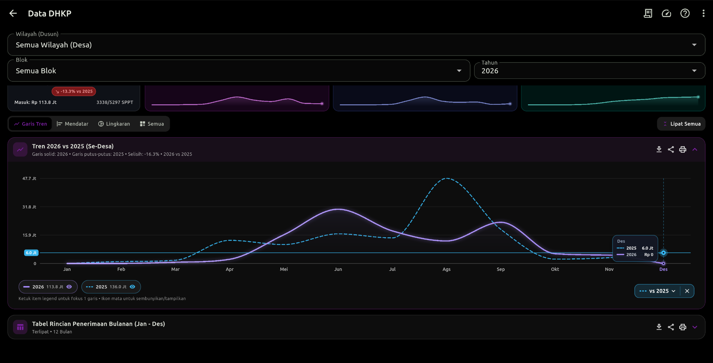<br /><sub><b>Overlay Garis Perbandingan Tren Pembayaran Antar Tahun Pajak</b></sub></td>
  </tr>
</table>
</details>

---

### 5. Peta Spasial Objek Pajak DHKP (GIS & Poligon Wilayah)

Dapat diakses langsung dari menu kanan atas Data DHKP → **Peta Objek Pajak (Eksperimental)** (`lib/map/dhkp_map_screen.dart` & `map_pin_store.dart`):
- **5 Layer Peta Interaktif (`flutter_map`)**: Google Satelit (Hybrid: Foto + Jalan), Google Satelit (Foto Udara Murni), Google Peta Jalan (Roadmap), OpenStreetMap, dan Peta Rupabumi Indonesia (BIG).
- **Sebaran Titik Objek Pajak (Tax Dots) & Multi-NOP Bucketing**: Menampilkan sebaran koordinat wajib pajak berbasis WGS84 beserta pewarnaan status (*Lunas*, *Belum Lunas*, *Blacklist*, *Target Pemda*) dan penyimpanan lokal `map_pins.json` dengan pembulatan kluster ~1,1 meter.
- **Pelacakan GPS Real-Time, Zona Kedusunan & Ekspor KML**: Menampilkan posisi petugas, poligon zona dusun dinamis, serta dukungan impor/ekspor berkas `.kml` terproteksi sanitasi XML/CDATA.

---

### 6. Dukungan Multi-Wilayah se-Kabupaten Cianjur (32 Kecamatan · 337 Desa)

Aplikasi mencakup katalog wilayah lengkap seluruh Kabupaten Cianjur (`cianjur_wilayah_data.dart`): **32 Kecamatan** dan **337 Desa/Kelurahan** beserta kode awalan NOP resmi **10 digit** (`3205` + kode kecamatan + kode desa). Pengguna dapat mengatur wilayah kerja utama melalui Wizard Awal ataupun menu **Wilayah Kerja & Profil Desa**.

<table>
  <tr>
    <td align="center" width="50%">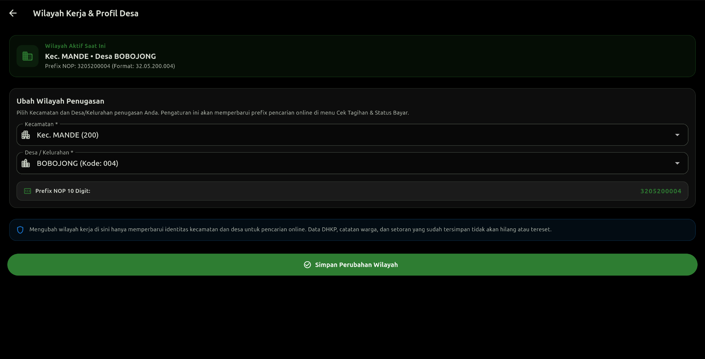<br /><sub><b>Pengaturan Wilayah Kerja, Profil Desa & Koordinat Dusun</b></sub></td>
    <td align="center" width="50%">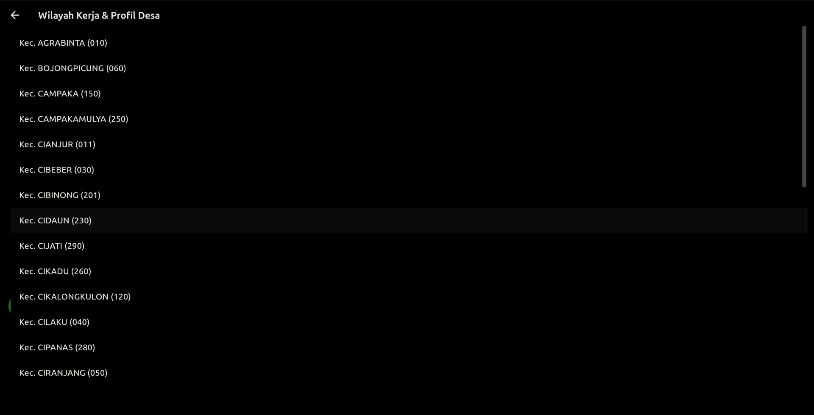<br /><sub><b>Daftar Lengkap 32 Kecamatan di Kabupaten Cianjur</b></sub></td>
  </tr>
  <tr>
    <td align="center" colspan="2">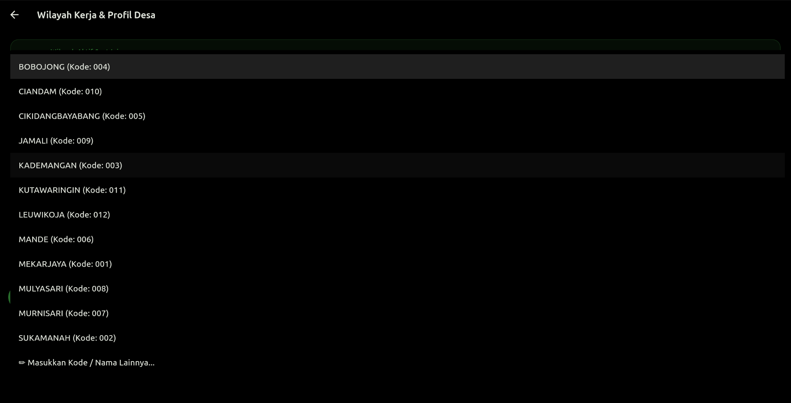<br /><sub><b>Pemilihan Desa/Kelurahan Otomatis Mengisi Prefix Kode NOP</b></sub></td>
  </tr>
</table>

---

### 7. Portal Staf V-Tax, Login MFA TOTP, Sinkronisasi & Generate DHKP Baru (Split DKH2)

Integrasi aman ke portal internal staf **`cianjurkab.v-tax.id`** menggunakan sesi kuki persisten (`_sharedCookieJar`), **Captcha OCR otomatis**, serta pengisian **TOTP 6 digit (RFC 6238)** otomatis jika rahasia Authenticator petugas telah disimpan di penyimpanan terenkripsi.

<table>
  <thead>
    <tr>
      <th align="center" width="26%">📱 Tampilan Mobile</th>
      <th align="center" width="74%">🖥️ Tampilan Desktop</th>
    </tr>
  </thead>
  <tbody>
    <tr>
      <td align="center">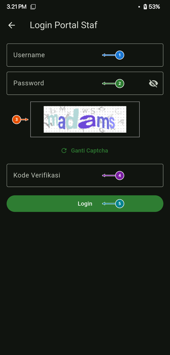<br /><sub><b>Login Portal Staf + Captcha (Mobile)</b></sub></td>
      <td align="center">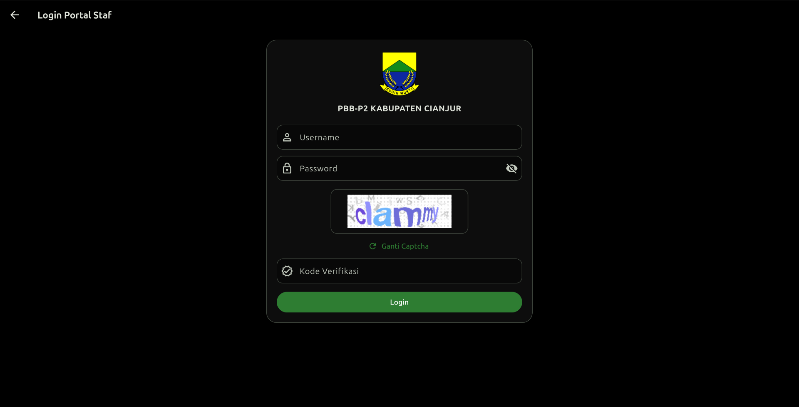<br /><sub><b>Portal Login Staf dengan Kredensial Terenkripsi (Desktop)</b></sub></td>
    </tr>
    <tr>
      <td align="center">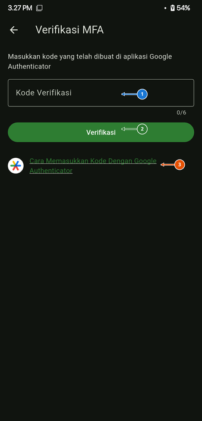<br /><sub><b>Otentikasi 2 Faktor TOTP (Mobile)</b></sub></td>
      <td align="center">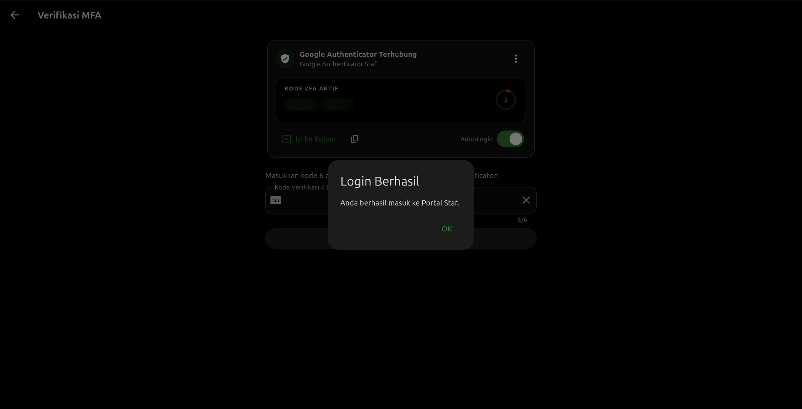<br /><sub><b>Verifikasi Kode TOTP 6 Digit Sekali Ketuk (Desktop)</b></sub></td>
    </tr>
    <tr>
      <td align="center">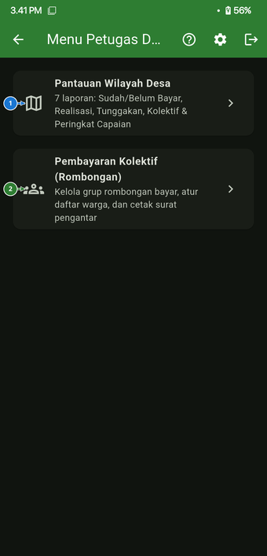<br /><sub><b>Menu Hub Petugas Desa (Mobile)</b></sub></td>
      <td align="center">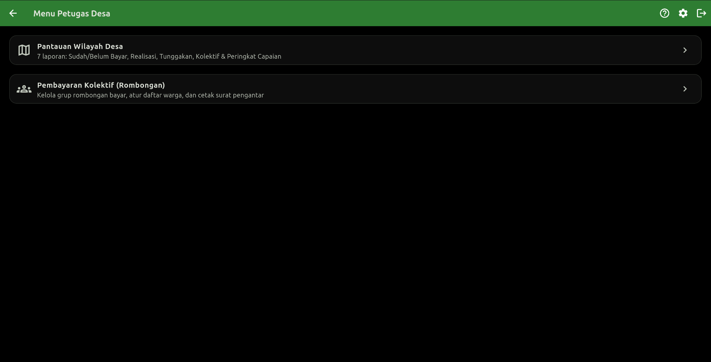<br /><sub><b>Menu Hub: Pantauan Wilayah & Pembayaran Kolektif (Desktop)</b></sub></td>
    </tr>
    <tr>
      <td align="center">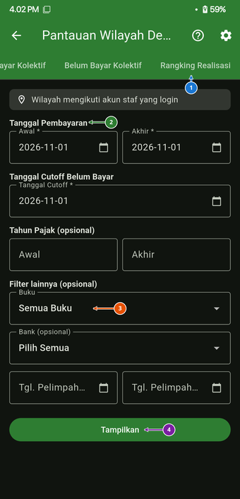<br /><sub><b>Rangking Realisasi Desa (Mobile)</b></sub></td>
      <td align="center">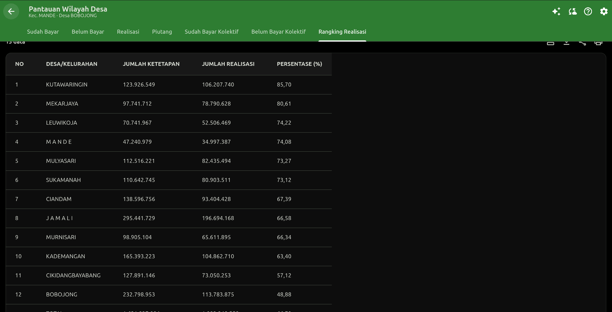<br /><sub><b>Tabel Capaian & Peringkat Realisasi se-Kecamatan/Kabupaten (Desktop)</b></sub></td>
    </tr>
  </tbody>
</table>

#### 🔹 7 Tab Pantauan Wilayah, Sinkronisasi DHKP & Generate DHKP Baru + Split DKH2
- **Sinkronkan DHKP**: Menarik pembaruan langsung dari Portal Staf ke Buku Catatan DHKP dengan pilihan *Hanya Pelunasan* atau *Keseluruhan DHKP* via paralel request + laporan NOP baru lunas.
- **Generate DHKP Baru (Mode Timpa)**: Menyusun database DHKP baru langsung dari Portal Staf V-Tax berdasarkan rentang tahun (`2015–sekarang`), pemetaan blok ke masing-masing dusun, koordinat kantor desa, serta opsi **Pecah & Ekspor per Dusun (`.dkhp` terenkripsi format `DKH2` AES-256-GCM 600k iterasi + Master Desa)** lengkap dengan pengamanan **kata sandi minimal 8 karakter**.

<details>
<summary><b>📸 Galeri Lengkap 6 Tab Pantauan Wilayah Lainnya, Sinkronisasi & Wizard Generate DHKP Baru (Desktop)</b></summary>
<br />
<table>
  <tr>
    <td align="center" width="50%">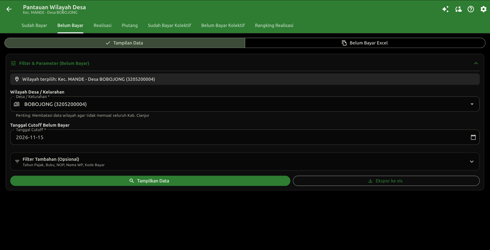<br /><sub><b>Tab Belum Bayar</b></sub></td>
    <td align="center" width="50%">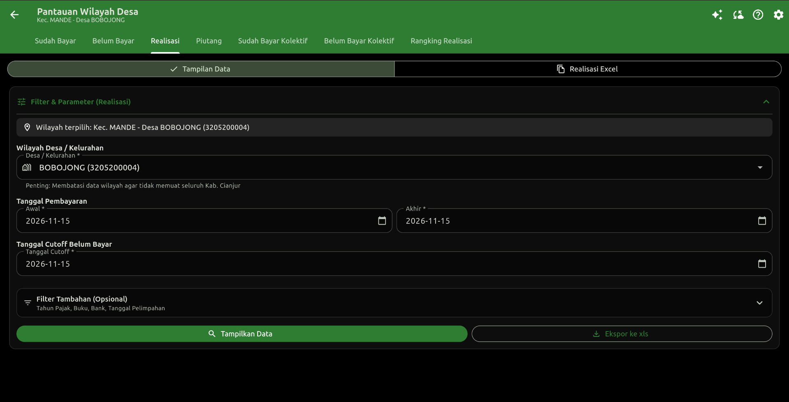<br /><sub><b>Tab Realisasi</b></sub></td>
  </tr>
  <tr>
    <td align="center">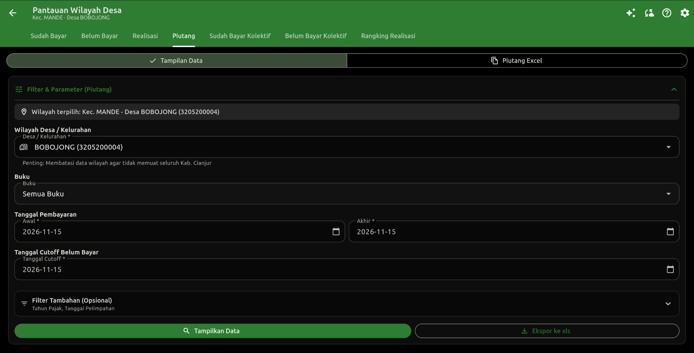<br /><sub><b>Tab Piutang</b></sub></td>
    <td align="center">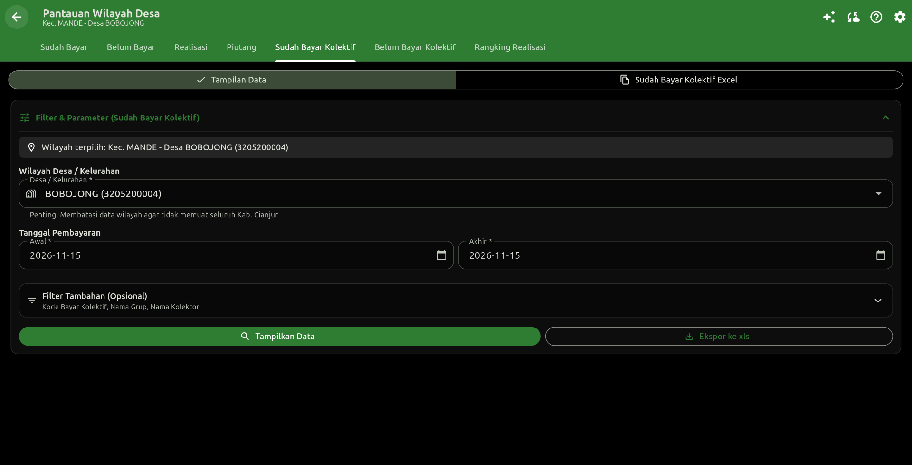<br /><sub><b>Tab Sudah Bayar Kolektif</b></sub></td>
  </tr>
  <tr>
    <td align="center">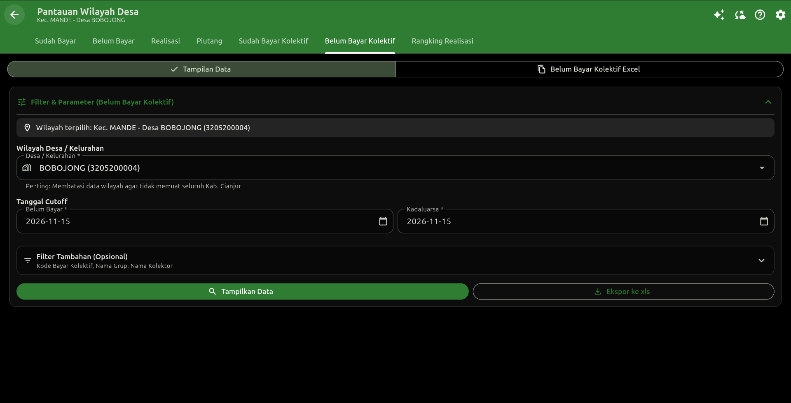<br /><sub><b>Tab Belum Bayar Kolektif</b></sub></td>
    <td align="center">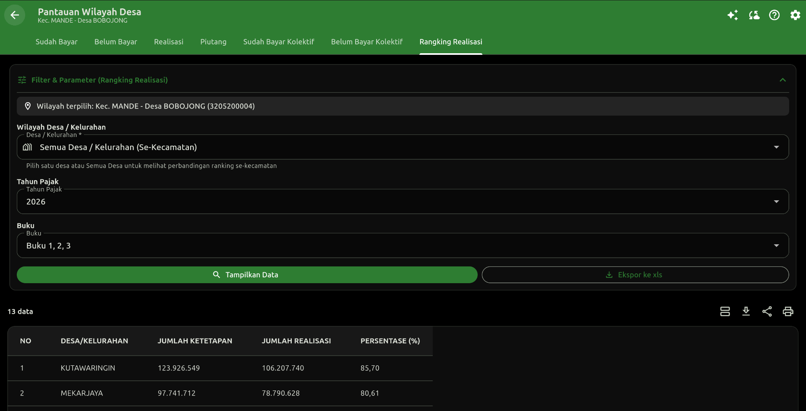<br /><sub><b>Filter Tab Rangking Realisasi</b></sub></td>
  </tr>
  <tr>
    <td align="center"><br /><sub><b>Modal Sinkronkan DHKP dari Portal Staf</b></sub></td>
    <td align="center"><br /><sub><b>Generate DHKP Baru (Bagian 1: Tahun & Wilayah)</b></sub></td>
  </tr>
  <tr>
    <td align="center"><br /><sub><b>Generate DHKP Baru (Bagian 2: Pemetaan Blok per Dusun)</b></sub></td>
    <td align="center"><br /><sub><b>Generate DHKP Baru (Bagian 3: Split .dkhp & Kata Sandi DKH2)</b></sub></td>
  </tr>
</table>
</details>

---

### 8. Manajemen Pembayaran Kolektif & Surat Pengantar

Kelola rombongan penyetoran kolektif desa (pembuatan grup baru, pengelolaan NOP anggota satu per satu maupun unggah berkas massal CSV/Excel/Teks, sinkronisasi otomatis satu kali saat daftar anggota grup pertama dibuka, serta pencetakan **Surat Pengantar PDF**). Demi keamanan transaksi keuangan, aplikasi memblokir pengiriman massal NOP kosong serta tidak mengeksekusi pembuatan kode Virtual Account pembayaran secara otomatis.

<table>
  <thead>
    <tr>
      <th align="center" width="26%">📱 Tampilan Mobile</th>
      <th align="center" width="74%">🖥️ Tampilan Desktop</th>
    </tr>
  </thead>
  <tbody>
    <tr>
      <td align="center"><br /><sub><b>Daftar Grup Kolektif (Mobile)</b></sub></td>
      <td align="center"><br /><sub><b>Daftar Grup Pembayaran Kolektif & Aksi Status (Desktop)</b></sub></td>
    </tr>
    <tr>
      <td align="center"><br /><sub><b>Menu Aksi / Buat Grup (Mobile)</b></sub></td>
      <td align="center"><br /><sub><b>Modal Pembuatan Grup Kolektif Baru (Desktop)</b></sub></td>
    </tr>
    <tr>
      <td align="center"><br /><sub><b>Kelola Anggota NOP (Mobile)</b></sub></td>
      <td align="center"><br /><sub><b>Kelola Anggota Grup Kolektif & Tambah Massal Berkas (Desktop)</b></sub></td>
    </tr>
  </tbody>
</table>

---

### 9. Cek Pajak Kendaraan Bermotor Jawa Barat (PKB)

Pengecekan Pajak Kendaraan Bermotor (PKB) wilayah Provinsi Jawa Barat menggunakan input nomor polisi (*F - xxxx - xxx*) beserta pilihan warna TNKB, dilengkapi pemindai pelat nomor lewat kamera (khusus Android) serta tautan langsung menuju portal pembayaran resmi Bapenda Jabar.

<table>
  <thead>
    <tr>
      <th align="center" width="26%">📱 Tampilan Mobile</th>
      <th align="center" width="74%">🖥️ Tampilan Desktop</th>
    </tr>
  </thead>
  <tbody>
    <tr>
      <td align="center"><br /><sub><b>Cek PKB Bapenda Jabar (Mobile)</b></sub></td>
      <td align="center"><br /><sub><b>Formulir Cek PKB Jawa Barat Responsif (Desktop)</b></sub></td>
    </tr>
  </tbody>
</table>

---

### 10. Cek Desil & Status Bansos Kemensos

Pengecekan peringkat kesejahteraan (**Desil 1–10**) serta kepesertaan Bantuan Sosial berdasarkan **NIK 16 digit** langsung ke layanan DTSEN Kemensos RI dengan verifikasi captcha gambar terintegrasi (dan pemindaian KTP/KK via kamera OCR khusus Android).

<table>
  <thead>
    <tr>
      <th align="center" width="26%">📱 Tampilan Mobile</th>
      <th align="center" width="74%">🖥️ Tampilan Desktop</th>
    </tr>
  </thead>
  <tbody>
    <tr>
      <td align="center"><br /><sub><b>Cek Desil & Bansos (Mobile)</b></sub></td>
      <td align="center"><br /><sub><b>Form Cek Desil Kemensos + Captcha (Desktop)</b></sub></td>
    </tr>
  </tbody>
</table>

<details>
<summary><b>📸 Contoh Pengisian NIK Captcha & Hasil Status Desil/Bansos (Desktop)</b></summary>
<br />
<table>
  <tr>
    <td align="center" width="50%"><br /><sub><b>Pengisian NIK & Verifikasi Captcha</b></sub></td>
    <td align="center" width="50%"><br /><sub><b>Kartu Hasil Desil & Status Kepesertaan Bantuan Sosial</b></sub></td>
  </tr>
</table>
</details>

---

### 11. Pembaca PDF Camelot, Penampil Spreadsheet & Kolase Foto F4

- **Pembaca PDF Camelot (`lib/document_preview_screen.dart`)**: Penampil PDF bawaan untuk berkas SPPT/STTS, hasil laporan DHKP, Surat Pengantar Kolektif, hingga file `.pdf` eksternal (maksimal `150 MB` tervalidasi *magic bytes* `%PDF-`). Dilengkapi **lapisan teks dapat diblok & disalin**, zoom halus ke titik ketuk (`double-tap` / `Ctrl+Scroll`), bilah penggeser cepat (*fast-scroll scrubber*), serta **cetak langsung ke driver printer OS (`Ctrl+P`)** pada Desktop.
- **Penampil Spreadsheet (`lib/spreadsheet_viewer_screen.dart`)**: Membaca dan mempaginasi berkas Excel (`.xlsx`, `.xls`) maupun `.csv` dalam mode *Hanya Lihat*, serta mempratinjau arsip terenkripsi (`.dkhp`, `.dhkp`, `.dat`) dengan pencarian & tombol langsung **"Impor ke Buku Catatan"**.
- **Kolase Gambar Dokumentasi F4 (`lib/kolase_foto_screen.dart`)**: Menggabungkan foto bukti penyerahan SPPT warga menjadi dokumen cetak PDF standar ukuran **F4 (Folio)** dengan pilihan template grid **`1x2`, `2x1`, `2x2`, `2x3`, `3x2`, hingga `3x3`**.

---

### 12. Buku Panduan Interaktif & Tur Fitur Langsung

Modul panduan visual bawaan (`UserGuideRepository`) berisi **19 Layar Fitur**, **91 Titik Panduan (*pinpoint*)**, dan **6 FAQ** pada tangkapan layar aplikasi lengkap dengan pan & zoom interaktif serta pencarian kata kunci. Selain itu, setiap modul memiliki **Tur Fitur Interaktif (*Spotlight Onboarding*)** yang memandu langkah demi langkah langsung di atas widget nyata.

<table>
  <thead>
    <tr>
      <th align="center" width="26%">📱 Tampilan Mobile</th>
      <th align="center" width="74%">🖥️ Tampilan Desktop</th>
    </tr>
  </thead>
  <tbody>
    <tr>
      <td align="center"><br /><sub><b>Buku Panduan Interaktif (Mobile)</b></sub></td>
      <td align="center"><br /><sub><b>Katalog 19 Layar & 91 Titik Panduan di Desktop</b></sub></td>
    </tr>
  </tbody>
</table>

---

### 13. Tema Adaptif, Keamanan Berlapis, Pencadangan & Legalitas

Panel Pengaturan menyatukan kontrol wilayah kerja, 4 mode tema & Material You, pengamanan berlapis (*AppLock* + *Kata Sandi Cadangan*), pencadangan delta `.dat`, buku panduan, cek pembaruan & bagikan aplikasi, serta kebijakan privasi dan syarat ketentuan.

<table>
  <thead>
    <tr>
      <th align="center" width="26%">📱 Tampilan Mobile</th>
      <th align="center" width="74%">🖥️ Tampilan Desktop</th>
    </tr>
  </thead>
  <tbody>
    <tr>
      <td align="center"><br /><sub><b>Pengaturan Utama (Mobile)</b></sub></td>
      <td align="center"><br /><sub><b>Menu Pengaturan Utama Desktop</b></sub></td>
    </tr>
    <tr>
      <td align="center"><br /><sub><b>Tema & Material You (Mobile)</b></sub></td>
      <td align="center"><br /><sub><b>Tema Hitam AMOLED (#000000) & Pilihan Warna Aksen (Desktop)</b></sub></td>
    </tr>
    <tr>
      <td align="center"><br /><sub><b>Keamanan Aplikasi (Mobile)</b></sub></td>
      <td align="center"><br /><sub><b>Pengaturan Kunci Aplikasi & Dialog Kata Sandi Cadangan (Min. 8 Karakter)</b></sub></td>
    </tr>
    <tr>
      <td align="center"><br /><sub><b>Pencadangan Data (Mobile)</b></sub></td>
      <td align="center"><br /><sub><b>Status Cadangan Delta DHKP, Penjadwalan & Koneksi Drive</b></sub></td>
    </tr>
    <tr>
      <td align="center"><br /><sub><b>Tentang & Pembaruan (Mobile)</b></sub></td>
      <td align="center"><br /><sub><b>Tentang Aplikasi, Pemeriksa Pembaruan & Bagikan Rilis</b></sub></td>
    </tr>
  </tbody>
</table>

<details>
<summary><b>📸 Galeri Tema Terang, Daftar Berkas Cadangan & Dokumen Legalitas Aplikasi</b></summary>
<br />
<table>
  <tr>
    <td align="center" width="50%"><br /><sub><b>Tema Terang (Light Mode) di Desktop</b></sub></td>
    <td align="center" width="50%"><br /><sub><b>Daftar Berkas Cadangan Lokal (.dat) dengan Aksi Bagikan & Hapus</b></sub></td>
  </tr>
  <tr>
    <td align="center"><br /><sub><b>Kebijakan Privasi (Mobile)</b></sub></td>
    <td align="center"><br /><sub><b>Syarat dan Ketentuan (Mobile)</b></sub></td>
  </tr>
</table>
</details>

---

## 🚀 Alur Pembaruan Otomatis

1. Pemeriksa pembaruan (`UpdateChecker`) memeriksa rilis terbaru pada repositori GitHub setiap 24 jam secara senyap maupun secara manual dari menu **Tentang Aplikasi → Periksa Pembaruan**.
2. Pada **Android**, pembaruan otomatis memilih **APK Split ABI yang sesuai CPU perangkat** (`arm64-v8a`, `armeabi-v7a`, atau `x86_64`). Pada **Windows & Linux**, pembaruan mengunduh paket installer/rilis resmi platform terkait.
3. Sebelum menjalankan instalasi, aplikasi mengunduh berkas ke nama sementara `.part`, memverifikasi kesesuaian **magic bytes header biner**, serta mencocokkan **checksum SHA-256** terhadap catatan/metadata rilis resmi (otomatis menghapus berkas jika gagal verifikasi).

---

## 🛠️ Panduan Pengembangan & Kompilasi

### Prasyarat
- Flutter SDK versi `>= 3.50.0` (mengikuti constraint Dart SDK `^3.14.0` di [`pubspec.yaml`](pubspec.yaml))
- Dart SDK versi `^3.14.0`
- Android Studio / Android SDK Platform Tools (Compile SDK `36`, JDK `17`, Gradle `9.3.1`, AGP `9.1.1`)
- Xcode (khusus kompilasi rilis iOS / App Store)
- Visual Studio Community 2022 dengan C++ Desktop Development & Inno Setup 6/7 (khusus Windows)
- GCC / Clang, CMake, Ninja, dan `libgtk-3-dev` (khusus Linux Desktop)

### Langkah Kompilasi

1. **Kloning Repositori**:
   ```bash
   git clone https://github.com/IkbalGumilar/Cek-PBB-Cianjur.git
   cd Cek-PBB-Cianjur
   ```

2. **Pasang Dependensi**:
   ```bash
   flutter pub get
   ```

3. **Konfigurasi OAuth Desktop (Opsional untuk Windows/Linux Google Drive Sync)**:
   Salin [`env.desktop.example.json`](env.desktop.example.json) menjadi `env.desktop.json` (diabaikan oleh `.gitignore`) lalu isi `GOOGLE_DESKTOP_CLIENT_ID` dan `GOOGLE_DESKTOP_CLIENT_SECRET`.

4. **Kompilasi Biner Rilis (Ramping & Terobfuskasi)**:
   - **Android Split APK (Rekomendasi untuk efisiensi ukuran berkas)**:
     ```bash
     flutter build apk --release --split-per-abi --obfuscate --split-debug-info=build/symbols/android --tree-shake-icons
     ```
     Menghasilkan paket APK terpisah berdasarkan arsitektur CPU pada direktori `build/app/outputs/flutter-apk/`:
     - `app-arm64-v8a-release.apk` (`20,9 MB` — Smartphone Android 64-bit modern)
     - `app-armeabi-v7a-release.apk` (`20,1 MB` — Perangkat Android 32-bit legacy)
     - `app-x86_64-release.apk` (`21,2 MB` — Emulator / perangkat x86_64)
     > [!TIP]
     > **Efisiensi Memori & Ukuran (`useLegacyPackaging` + `R8` + `split-debug-info`)**  
     > Konfigurasi [`android/app/build.gradle.kts`](android/app/build.gradle.kts) mengaktifkan `isMinifyEnabled = true`, `isShrinkResources = true`, serta `packaging { jniLibs { useLegacyPackaging = true } }`, dipadukan dengan `--split-debug-info` dan `--tree-shake-icons` agar biner tetap ramping dan simbol debug terpisah.
   - **Android Universal APK (Berkas gabungan seluruh ABI)**:
     ```bash
     flutter build apk --release --obfuscate --split-debug-info=build/symbols/android --tree-shake-icons
     ```
   - **Windows Desktop (Otomatis Portable ZIP + Installer Inno Setup EXE + Checksum SHA-256)**:
     Cukup jalankan satu skrip otomatis dari root proyek:
     ```cmd
     tool\build_windows.bat
     ```
     Atau kompilasi manual (lihat panduan lengkap di [`BUILD_WINDOWS.md`](BUILD_WINDOWS.md)):
     ```cmd
     flutter build windows --release --obfuscate --split-debug-info=build\symbols\windows --tree-shake-icons --dart-define-from-file=env.desktop.json
     "C:\Program Files (x86)\Inno Setup 6\ISCC.exe" windows\installer.iss
     ```
     Hasil biner rilis di folder `dist\`:
     - `dist\Cek-PBB-Cianjur-Setup-v1.0.0.exe` (`16 MB` — Installer Mandiri Inno Setup)
     - `dist\Cek-PBB-Cianjur-Portable-v1.0.0.zip` (`19 MB` — Portable ZIP x64)
     - `dist\Cek-PBB-Cianjur-v1.0.0-checksums.sha256` (Checksum SHA-256 tergabung seluruh platform)
   - **Linux Desktop**:
     ```bash
     flutter build linux --release --obfuscate --split-debug-info=build/symbols/linux --tree-shake-icons --dart-define-from-file=env.desktop.json
     ```
     Biner rilis dan pustaka pendukung dihasilkan di `build/linux/x64/release/bundle/`, serta arsip portabel terkompresi di `dist/Cek-PBB-Cianjur-Linux-x64-v1.0.0.tar.gz` (`17 MB`).

5. **Verifikasi Pengujian & Analisis Statis**:
   ```bash
   flutter analyze
   flutter test
   ```
   *(Terverifikasi pada `v1.0.0`: `0` isu analisis statis dan `282/282` Unit & Widget Tests lolos).*

> [!IMPORTANT]
> **Penandatanganan Rilis Android (Keystore)**  
> Kompilasi rilis Android membutuhkan konfigurasi berkas `android/key.properties` yang merujuk pada berkas keystore penandatanganan (`.jks`). Berkas ini tidak disertakan di dalam repositori publik demi menjaga integritas dan keamanan aplikasi.

---

## ⚖️ Pernyataan Privasi & Penafian

1. **Independensi Pengembang**: Aplikasi ini dikembangkan secara independen oleh pengembang sebagai alat bantu kerja operasional lapangan bagi petugas/kolektor desa di lingkungan Kabupaten Cianjur. Aplikasi ini bukan merupakan aplikasi resmi yang diterbitkan secara kelembagaan oleh Badan Pendapatan Daerah (BAPENDA) Kabupaten Cianjur.
2. **Kerahasiaan Data**: Seluruh pemrosesan teks, OCR dokumen, enkripsi DHKP (`DKH2`), dan verifikasi data berlangsung secara lokal di perangkat masing-masing pengguna. Tidak ada data pribadi warga, dokumen KTP/KK, foto objek pajak, atau kata sandi yang dikirimkan ke peladen pihak ketiga selain komunikasi terenkripsi langsung ke portal resmi terkait (BAPENDA Cianjur, Bapenda Jabar, Kemensos RI, serta Google Drive atas otorisasi eksplisit pengguna).
3. **Hak Cipta Layanan**: Hak cipta nama, lambang daerah, serta infrastruktur portal layanan publik sepenuhnya merupakan milik Pemerintah Kabupaten Cianjur dan instansi/kementerian terkait.

---

## 📄 Lisensi

Proyek ini didistribusikan di bawah lisensi terbuka **GNU General Public License v3.0 (GPL-3.0)**. Lihat berkas [LICENSE](LICENSE) untuk ketentuan lengkapnya.
